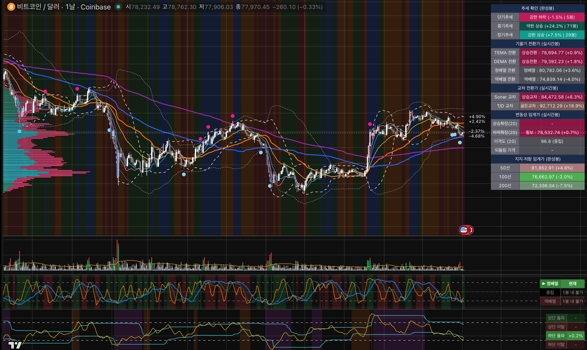

# KJH-Trading

CEO 매매 차트(**CME_MINI:NQ1! 일봉**)에 올린 지표의 사용 설명서입니다.
메인 지표는 **4종 — Auto VWAP · Triple-Stochastic-Wave · cRSI · Volume-Pressure-Tracker** 이고, **VRVP**(TradingView 내장)는 가격대별 거래량을 보는 참고용입니다.

핵심 원칙은 하나입니다. **신호 하나를 믿지 않는다.** 네 지표가 같은 방향을 가리키는지 함께 봅니다.



> 저장소: [`github.com/heum-junghwankim/KJH-Trading`](https://github.com/heum-junghwankim/KJH-Trading)

| 지표 | 한 줄 역할 | 주로 보는 것 |
| --- | --- | --- |
| **Auto VWAP** (가격 차트 위) | 추세와 가격 위치 | 평균 단가 밴드, 이동평균, 상태 테이블 |
| **Triple-Stochastic-Wave** (아래 패널) | 단기 모멘텀 타이밍 | 3개 스토캐스틱의 순서(정배열/역배열) |
| **cRSI** (아래 패널) | 과열·침체와 사이클 | 평활 RSI와 동적 밴드 |
| **Volume-Pressure-Tracker** (아래 패널) | 거래량 확인 | 거래량이 평소보다 큰지, 매수·매도 중 어느 쪽 몫이 큰지 |
| **VRVP** (가격 차트 위, 내장·참고용) | 가격대별 거래량 | 매물대, POC |

**목차**

1. [지표 가이드](#1-지표-가이드) — [1-1 Auto VWAP](#1-1-auto-vwap) · [1-2 Triple-Stochastic-Wave](#1-2-triple-stochastic-wave-삼중-스토캐스틱) · [1-3 cRSI](#1-3-crsi-rsi-cyclic-smoothed) · [1-4 Volume-Pressure-Tracker](#1-4-volume-pressure-tracker-거래량-압력) · [1-5 VRVP](#1-5-vrvp-참고용-tradingview-내장) · [1-6 메인 4종 함께 보는 법](#1-6-메인-4종-함께-보는-법)
2. [매매 전략 (가설)](#2-매매-전략-가설) — [전략별 예시 차트](#전략별-예시-차트) · [2-0 퀵 레퍼런스](#2-0-퀵-레퍼런스) · [2-1 용어](#2-1-용어) · [2-2 판정 위계와 상태 점수판](#2-2-판정-위계와-상태-점수판) · [2-3 셀별 상태 분류](#2-3-셀별-상태-분류) · [2-4 운용 모드](#2-4-운용-모드-데이--스윙) · [2-5 공통 리스크 · 사이징](#2-5-공통-리스크--사이징) · [2-6 진입 · 청산 플레이북](#2-6-진입--청산-플레이북) · [2-7 전략 A 역추세](#2-7-전략-a--역추세) · [2-8 전략 B 추세 예측](#2-8-전략-b--추세-예측) · [2-9 전략 C 추세 확정](#2-9-전략-c--추세-확정) · [2-10 세 전략 비교](#2-10-세-전략-비교) · [2-11 대기 리스트 작성법](#2-11-대기-리스트-작성법) · [2-12 검증 계획](#2-12-검증-계획)
3. [Claude Code ↔ TradingView MCP 연결](#3-claude-code--tradingview-mcp-연결) — [3-1 공식 TradingView MCP](#3-1-공식-tradingview-mcp) · [3-2 TradingView Desktop MCP](#3-2-tradingview-desktop-mcp)

> 매매 전략(진입·청산 규칙)은 [2. 매매 전략 (가설)](#2-매매-전략-가설)에 있습니다. 모두 백테스트되지 않은 **미검증 가설**이며, 검증을 통과하고 CEO 승인을 받기 전에는 실매매 규칙으로 쓰지 않습니다.

---

## 1. 지표 가이드

지표마다 `무엇을 재나 → 차트에서 읽는 법 → 핵심 숫자 → 잘 맞는 국면 → 흔한 실수` 순서입니다. 숫자는 모두 소스 기본값입니다.

> **공통 주의 3가지**
> 1. 어느 지표도 단독 진입 근거가 아닙니다.
> 2. 판단은 **마감된 봉** 기준으로 합니다. 형성 중인 봉의 값·색·마커는 틱마다 바뀌고 사라질 수도 있습니다.
> 3. 테이블의 "가격"·"%"는 "이 종가로 마감하면 상태가 바뀐다"는 **조건**입니다. 예측이 아닙니다.

### 1-1. Auto VWAP

**무엇을 재나** — 최근 20봉 동안 거래된 물량의 평균 단가(VWAP)를 기준으로, 지금 가격이 평소보다 얼마나 멀리 나왔는지와 이동평균들이 어느 방향으로 정렬됐는지를 봅니다. 비유하면 "최근 참가자들의 평균 매입가와, 그 평균에서 벗어난 거리".

**차트에서 읽는 법**
- **점선 밴드 2쌍** — 흰 대시 = 최근 20봉 VWAP의 ±2σ, 회색 점 = 최근 50봉 VWAP의 ±2σ. σ는 기본값에서 로그 가격의 거래량 가중 표준편차이며, 밴드는 `VWAP × e^(±2σ)`입니다. VWAP 중앙선은 기본으로 숨겨져 있습니다.
- **리본 3선** (종가 기준, 길이 20) — EMA 노랑 · DEMA 하늘 · TEMA 분홍. TEMA가 가장 빠르고 EMA가 가장 느립니다.
- **거래량 가중선** — 50선 주황 · 100선 파랑 · 200선 보라 (VWMA, 종가 기준).
- **배경색 (Sonar 모멘텀)** — Sonar = EMA20 − 9봉 전 EMA20, Signal = Sonar의 EMA9. Sonar가 Signal 위 = 골든, 아래 = 데드. 골든이면서 상승 밴드워킹이면 파랑, 그 밖의 골든은 녹색, 데드이면서 하락 밴드워킹이면 빨강, 그 밖의 데드는 주황입니다.
- **캔들 색 덮어쓰기** — 붉은 캔들 = 과매수 극단, 파랑 캔들 = 과매도 극단(아래 "핵심 숫자" 참고).
- **원 마커** — 하늘색 원(봉 아래) / 분홍 원(봉 위) = Williams %R(20) 1봉 다이버전스.
- **우측 상단 상태 테이블** — 아래 표 참고.

**핵심 숫자** — VWAP 20봉(소스 hlc3), 밴드 ±2σ(로그), 세트 B 50봉, 리본 20, VWMA 50/100/200, Sonar 20/9/9, %R 20(−80/−20). 극단 캔들 = cRSI(주기 20 기준) ≥ 70 이면서 고가가 볼린저(20, 2σ) 상단을 캔들 길이의 30% 이상 넘은 봉. 이 색은 그 봉 하나로 끝나지 않고, 이격도(종가 ÷ SMA20)가 중립으로 돌아올 때까지 다음 봉들도 같은 색으로 칠합니다. 과매도(파랑)는 대칭(≤ 30, 하단 이탈).

**Williams %R 원 마커** — %R 라인은 눈금(−100~0)이 가격과 달라 가격 차트에 그리지 않고, 다이버전스가 난 봉에만 원을 찍습니다. %R(20)은 종가가 최근 20봉 고저 범위의 어디에 있는지를 −100(최저)~0(최고)으로 나타냅니다. 판정은 직전 봉과 이번 봉 **1봉 비교**입니다(피벗 기반 아님).

| 원 | 위치 · 기본색 | 조건 (모두 충족) | 읽는 법 |
| --- | --- | --- | --- |
| 하늘색 원 | 봉 아래 · `#81D4FA` | 직전 봉 %R < −80, 이번 봉 종가 < 직전 종가, 이번 봉 %R > 직전 %R | 과매도 구간에서 종가는 내렸는데 %R은 올랐다 = **저가 거부**. 하락 힘이 약해지는 징후 |
| 분홍 원 | 봉 위 · `#FF1493` | 직전 봉 %R > −20, 이번 봉 종가 > 직전 종가, 이번 봉 %R < 직전 %R | 과매수 구간에서 종가는 올랐는데 %R은 내렸다 = **고가 거부**. 상승 힘이 약해지는 징후 |

- **리페인팅**: 이번 봉 종가와 %R로 판정하므로 형성 중인 봉에서는 원이 켜졌다 꺼질 수 있습니다. 봉이 마감되면 확정되며, 미래 데이터는 쓰지 않습니다. **마감봉의 원만** 인정합니다.
- **2절에서 쓰는 법**: 원은 **단독 진입 신호가 아닙니다.** 이격도와 같은 "20봉 위치" 정보라 절대 기준의 **④ 변동성 축**에 들어갑니다. 전략 A에서는 **필수**(A2: 롱 = 최근 3봉 내 하늘색 원, 숏 = 분홍 원), 전략 B·C에서는 **최근 5봉 내 반대 방향 원 = 변동성 불리(금지)**(롱이면 분홍 원), 전략 B에서는 **같은 방향 원 = 역행 경험(B2) 인정**입니다([2-2](#2-2-판정-위계와-상태-점수판) · [2-7](#2-7-전략-a--역추세) · [2-8](#2-8-전략-b--추세-예측) · [2-9](#2-9-전략-c--추세-확정)). 1봉 비교라 노이즈가 많고, 연속으로 찍히면 1회로 셉니다.
- **설정**: `윌리엄스 %R 다이버전스` 그룹 — `%R 다이버전스 원 표시`(기본 ON), `윌리엄스 %R 길이`(20), `%R 하단 밴드`(−80), `%R 상단 밴드`(−20), 원 색 2개.

**상태 테이블 — 섹션별 핵심** (기본 레이아웃 가로형, 세로형 선택 가능. 섹션 제목 괄호 = 기준봉)

| 섹션 (기본 기준봉) | 이 섹션이 답하는 질문 | 핵심 행 |
| --- | --- | --- |
| ① 추세 확인 (완성봉) | 이동평균 기준으로 추세가 이미 정해졌나? (후행) | `단기추세` VWMA20(차트에 안 그림) vs 50 · `중기추세` 50 vs 100 · `장기추세` 100 vs 200. 값: `골든/데드 크로스`, `(강한/약한) 상승·하락 (+x.x% \| N봉)` |
| ② 기울기 전환가 (실시간봉) | 다음 봉이 얼마에 마감하면 리본선이 꺾이나? | `TEMA 전환` · `DEMA 전환` · `정배열 전환` · `역배열 전환` |
| ③ 교차 전환가 (실시간봉) | 다음 봉이 얼마에 마감하면 두 선이 교차하나? | `Sonar 교차`(배경색 방향 반전) · `T/D 교차`(TEMA와 DEMA 교차) |
| ④ 변동성 임계가 (실시간봉) | 밴드를 타고 달리는 중인가, 평균에서 너무 멀어졌나? | `상승확장(20)` · `하락확장(20)` · `상승확장(50)` · `하락확장(50)` · `이격도` |
| ⑤ 지지·저항 임계가 (완성봉) | 50/100/200선이 지금 지지인가 저항인가? | `50선` · `100선` · `200선` (값 = 선 가격과 종가 대비 %) |

- **색**: 청록 = 상승 쪽, 자홍 = 하락 쪽, 회색 = 중립·데이터 부족. ⑤만 녹 = 지지, 빨강 = 저항, 흐린 녹/흐린 빨강 = 판정 없이 선 위/아래.
- **① 강약**: 크로스 후 5봉 동안은 `상승`/`하락`만 표시합니다. 그 뒤 두 선 간격이 5봉 전보다 ATR14 × 0.25 넘게 벌어지면 `강한`, 그만큼 좁아지거나 간격이 종가의 4% 이하이면 `약한`입니다. 간격이 4% 이하여도 벌어지는 중이면 `강한`입니다.
- **② 정배열 = 선의 위치 순서가 아닙니다.** 세 선의 **1봉 기울기**가 TEMA > DEMA > EMA 순이면 정배열, 반대면 역배열입니다. 이 두 행의 가격은 근사값입니다.
- **②③④의 가격** (실시간봉 모드): 지금 형성 중인 봉을 고정으로 보고 **다음 봉 종가**가 그 가격이면 상태가 바뀐다는 뜻입니다. 기준가 대비 ±50%를 넘으면 `도달불가`로 표시합니다.
- **④ 밴드워킹**: 종가가 20봉 VWAP의 +1σ 위이고 VWAP의 5봉 기울기가 상승이면(기울기가 평탄하면 밴드폭 확장 중일 때) 상승 워킹입니다. 하락은 대칭입니다. +2σ 위에 있더라도 밴드가 넓어지지 않고 VWAP가 평탄·하락이면 워킹에서 뺍니다. 확장 행의 가격은 수치 탐색으로 구한 근사값이며, 다음 봉 거래량은 기준봉과 같다고 가정합니다. 값은 `가격 (±x.x% | N봉)` 형식이고(예: `하락확장(20)`에 `횡보 : 13,000 (+2.0% | 2봉)` = 하락 워킹 2봉째), `N봉`은 현재 국면(상승 워킹 / 하락 워킹 / 횡보)이 이어진 봉 수로 국면이 바뀌면 1부터 다시 셉니다(같은 기간 두 행 공통, 실시간봉 모드면 형성 중인 봉 포함). `상승확장(50)`·`하락확장(50)`은 같은 판정식을 50봉 VWAP·밴드로 적용한 행이며, 20 쌍과 국면·N을 따로 셉니다.
- **④ 이격도**: 값은 `{20 기준} | {50 기준} ({판정})`입니다(예: `96.6 | 95.6 (되돌림 주의)`). 20 기준 = 종가 ÷ SMA20 × 100, 50 기준 = 종가 ÷ SMA50 × 100, 괄호 = 20 기준 판정. 판정 기준은 고정 ±10%와 최근 50봉 이격도 표준편차 × 1.5 두 가지이며 20 기준에만 적용합니다. 하나를 넘으면 `되돌림 주의`, 둘 다 넘으면 `되돌림 확실`이고, 셀 색도 20 기준입니다.

**잘 맞는 국면 / 약한 국면** — 추세 구간에서는 리본·VWMA 정렬과 밴드워킹이 방향을 잘 요약합니다. 횡보 구간에서는 리본 기울기와 Sonar가 자주 뒤집혀 테이블 값이 계속 바뀝니다(휩쏘). 이 성향은 일반론이며, 펀드 데이터로 검증하지 않았습니다.

**초보가 흔히 하는 실수**
- 녹색 배경을 "상승 추세"로 읽는 것. Sonar 골든은 "9봉 모멘텀이 자기 평균보다 좋아졌다"는 뜻이라, 하락이 둔화되기만 해도 켜집니다.
- 실시간봉 값(②③④, 배경색, 원 마커, 캔들색)으로 바로 판단하는 것. 형성 중에는 켜졌다 꺼질 수 있으니 마감 후에 확인합니다.

### 1-2. Triple-Stochastic-Wave (삼중 스토캐스틱)

**무엇을 재나** — 기간이 다른 스토캐스틱 3개가 "최근 고저 범위 안에서 종가가 어디쯤인가"(0~100)를 각각 잽니다. 짧은 기간 값이 긴 기간 값보다 위에 있으면 단기 흐름이 더 강하다는 뜻입니다. 비유하면 단거리·중거리·장거리 선수의 순위표.

**차트에서 읽는 법**
- **선 3개** — Fast 주황 · Mid 청록 · Slow 파랑(굵게). `Basis` 설정(기본 `K선`)에 따라 %K 또는 %D 한 종류만 그립니다.
- **녹색 배경 = 정배열** (Fast > Mid > Slow), **빨간 배경 = 역배열** (Fast < Mid < Slow). 나머지 순서는 배경이 없습니다(중립).
- **수평선** — 80 / 50 / 20.
- **우측 상단 테이블** (3행 `정배열`·`중립`·`역배열`) — 각 순서가 되려면 종가가 기준 종가 대비 몇 % 움직여야 하는지 보여줍니다. 이미 그 상태인 행은 라벨 앞에 `▶`, 값은 `현재`입니다. 한 봉 종가로 만들 수 없으면 `1봉 내 불가`입니다. 기본 `실시간봉` 모드는 **지금 형성 중인 봉**의 종가 조건입니다(Auto VWAP·cRSI 테이블의 "다음 봉"과 다릅니다).

**핵심 숫자** — Fast 5/3/3 · Mid 10/6/6 · Slow 20/9/9 (기간/%K 평활/%D 평활). `raw = 100 × (종가 − N봉 최저) / (N봉 최고 − N봉 최저)`, `%K = SMA(raw)`, `%D = SMA(%K)`. 알림 2종은 세 스토캐스틱 각각의 %K가 자기 %D 위(또는 아래)에 있을 때입니다. 배경의 순서 판정과는 다른 조건입니다.

**잘 맞는 국면 / 약한 국면** — 방향이 있는 구간의 눌림·반등 타이밍을 볼 때 잘 맞습니다. 횡보에서는 배경이 자주 바뀌고, 강한 추세에서는 80 위나 20 아래에 오래 머뭅니다(일반론, 펀드 데이터 미검증).

**초보가 흔히 하는 실수**
- 80 위를 곧바로 "매도", 20 아래를 "매수"로 읽는 것. 강한 추세에서는 극단 구간이 오래 갑니다.
- 정배열을 "상승 추세"로 읽는 것. 정배열은 최근 5~20봉 범위 안의 상대 위치일 뿐이며 큰 추세는 Auto VWAP ①로 봅니다.

### 1-3. cRSI (RSI Cyclic Smoothed)

**무엇을 재나** — RSI를 시장 사이클 길이에 맞춰 평활한 선(cRSI)과, 최근 40봉 동안 그 선이 실제로 움직인 범위로 만든 **동적 과열/침체 밴드**입니다. 고정 30/70 대신 "요즘 기준으로 높은가 낮은가"를 봅니다.

**차트에서 읽는 법**
- **골드 선** = cRSI. **시안 선 2개** = 상단 밴드(최근 40봉 cRSI 값의 상위 약 10% 경계) / 하단 밴드(하위 약 10% 경계).
- **회색 점선** = 고정 참고선 30 / 70.
- **배경** — 진한 주황 = 밴드폭(상단 − 하단) ≤ 20, 진폭 수축. 보라 = 밴드폭 ≥ 35, 진폭 확장. 단위는 cRSI 점수(0~100)입니다.
- **▲ / ▼** = 상승/하락 다이버전스. 보라(확장) 배경일 때만 그립니다.
- **우측 상단 테이블** (`상단 돌파`·`상단 이탈`·`하단 돌파`·`하단 이탈`) — 다음 봉 종가가 기준 종가 대비 몇 %이면 cRSI가 밴드를 넘는지 보여줍니다. 지금 상태에 해당하는 행만 값이 나오고 나머지는 `-`입니다. 값이 **노랑 굵게**이면 보합이나 반대 방향 소폭 움직임으로도 다음 봉에 교차한다는 뜻입니다.

**핵심 숫자** — Dominant Cycle 20 → RSI 길이 10, 위상 지연 4봉, 평활 계수 2/11, 밴드 계산 구간 40봉, 밴드 경계 10%. 식: `cRSI = (2/11) × (2·RSI − RSI[4봉 전]) + (9/11) × 직전 cRSI`. 수축/확장 기준 20 / 35.

**잘 맞는 국면 / 약한 국면** — 사이클이 비교적 규칙적인 박스·완만한 추세에서 밴드 이탈과 복귀가 의미 있게 나옵니다. 강한 추세에서는 밴드도 따라 움직여 한쪽 밴드 근처에 붙어 있을 수 있습니다(일반론, 펀드 데이터 미검증).

**초보가 흔히 하는 실수**
- 다이버전스 삼각형을 실시간 신호로 쓰는 것. 피벗은 오른쪽 5봉이 지나야 확인되므로 **5봉 늦게, 5봉 과거 위치에** 찍힙니다. 보라 배경 조건도 삼각형 위치가 아니라 확인 시점의 봉에서 봅니다.
- 하단 밴드 아래를 곧바로 "바닥"으로 읽는 것. 밴드는 최근 40봉 분포일 뿐이라 하락 추세에서는 함께 내려갑니다.

### 1-4. Volume-Pressure-Tracker (거래량 압력)

**무엇을 재나** — 봉마다 거래량을 종가 위치로 매수 몫과 매도 몫으로 나눠 **추정**하고, 거래량이 평소보다 큰지 봅니다. 실제 체결(호가) 데이터가 아니라 "종가가 고가 쪽이면 매수 몫이 크다"는 근사입니다.

**차트에서 읽는 법**
- **막대** — 전체 거래량(매도색) 위에 매수 몫(매수색)을 겹쳐 그립니다. 매수 몫 = `거래량 × (종가 − 저가) / (고가 − 저가)`. 고가 = 저가인 봉은 반씩 나눕니다.
- **막대 색** — 평소: 매수 흰색 · 매도 회색. 거래량이 20봉 평균의 2배를 넘는 봉: 매수 라임 · 매도 빨강.
- **주황 선** = 거래량 20봉 평균.
- **테이블 3행** — `거래량 압력`: 이번 봉 거래량이 20봉 평균보다 크고 종가가 봉 중간값((고가+저가)/2)보다 위면 `롱 유리`, 아래면 `숏 유리`. 거래량이 평균 이하이거나, 종가가 정확히 중간값이거나, 고가 = 저가면 `중립`. `압력 방향`: 최근 5봉 매수 합 ÷ 매도 합이 1.2배를 넘으면 `매수`, 반대로 1.2배를 넘으면 `매도`, 그 사이는 `중립`. `평균선(SMA)`: 최근 5봉 평균 ÷ 20봉 평균이 1.2 초과면 `상회`, 1/1.2(약 0.83) 미만이면 `하회`(회색), 그 사이는 `보통`.

**핵심 숫자** — 비교 20봉, 비정상 배수 1.0(= 평균의 2배 초과), 평균선 20, 비교 봉 수 N = 5, 임계 k = 1.2. 평균에 현재 봉도 들어가므로 "2배 초과"는 직전 19봉 평균 대비로는 약 2.11배 초과입니다. `압력 방향`의 1.2배는 매수 몫이 약 54.5%를 넘는다는 뜻입니다.

**잘 맞는 국면 / 약한 국면** — 돌파나 급변 봉에 거래량이 실렸는지 확인할 때 유용합니다. 꼬리가 긴 봉, 갭, 장중 왕복이 큰 봉에서는 종가 위치 추정이 실제 매수·매도와 크게 다를 수 있습니다(일반론, 펀드 데이터 미검증).

**초보가 흔히 하는 실수**
- 장중에 `중립`을 "힘이 없다"로 읽는 것. 형성 중인 봉은 거래량이 아직 덜 쌓여 평균보다 작게 나오기 쉽습니다. 마감 후에 봅니다.
- 라임/빨강 막대를 매수/매도 신호로 쓰는 것. 큰 거래량은 추세 시작에도, 추세 끝(투매·과열)에도 나옵니다.

### 1-5. VRVP (참고용, TradingView 내장)

화면에 보이는 구간의 거래량을 **가격대별 가로 막대**로 쌓아 거래가 몰린 가격(매물대)을 보여줍니다. POC = 거래량이 가장 많은 가격, VAH/VAL = 거래량 70%가 몰린 범위의 위/아래 끝(현재 차트 설정). 화면을 스크롤·확대하면 계산 구간이 바뀌어 **POC도 바뀝니다**. 레벨을 기록할 때는 어느 구간 기준인지 함께 남깁니다. 연속 선물(NQ1!)은 롤오버 구간 거래량이 섞입니다. 메인 지표가 아니므로 판단 근거가 아니라 레벨 참고용으로만 씁니다.

### 1-6. 메인 4종 함께 보는 법

| 지표 | 맡은 질문 |
| --- | --- |
| Auto VWAP | **추세와 위치** — 큰 방향은 어디이고, 가격이 평균에서 얼마나 떨어져 있나 |
| Triple-Stochastic-Wave | **모멘텀 타이밍** — 단기 흐름이 지금 같은 방향으로 정렬됐나 |
| cRSI | **과열과 사이클** — 최근 기준으로 너무 올랐거나 내렸나 |
| Volume-Pressure-Tracker | **거래량 확인** — 움직임에 거래량이 실렸나 |

- **정렬**: 네 지표가 같은 쪽을 가리키면(예: VWAP 추세 상승 + 스토캐스틱 정배열 + cRSI 과열 아님 + 거래량 평균 위) 상태가 한 방향으로 모였다고 읽습니다.
- **충돌**: 서로 다른 쪽을 가리키면 국면이 불분명하다는 정보로 읽습니다. 어느 한 지표를 골라 믿지 않습니다.
- **역할이 다른 정보만 셉니다.** 스토캐스틱과 cRSI는 둘 다 가격에서 나온 오실레이터라 겹치는 정보가 많습니다. 두 개가 같은 방향이라고 근거가 두 배가 되지는 않습니다.
- **주의: 이 조합이 수익(엣지)을 낸다는 것은 아직 검증되지 않았습니다.** 위 내용은 읽는 순서일 뿐 진입·청산 규칙이 아닙니다. 규칙은 [2. 매매 전략 (가설)](#2-매매-전략-가설)에 있으며, 그 역시 거래비용을 넣은 표본 외 검증과 CEO 승인 전에는 실매매 규칙이 아닙니다.

---

## 2. 매매 전략 (가설)

> **경고 — 모든 진입 규칙과 승률·R:R 수치는 백테스트되지 않은 가설·가정이며, 검증 전에는 실매매 규칙으로 쓰지 않는다.**
> - 펀드 데이터로 엣지(기댓값 > 0)가 확인된 규칙은 아직 하나도 없습니다. 이번 판정 위계 재설계(2026-11, CEO 결정·알고리즘 수학자 설계)도 **전체가 백테스트되지 않은 가설**입니다.
> - 수학자 의견: ①을 보조 기준으로 내리면 숏이 열리지만, NQ의 양(+) 드리프트가 숏에 거래당 약 0.1~0.25R의 역풍을 줍니다. [2-12](#2-12-검증-계획) 12번(방향·드리프트)을 먼저 수행해야 합니다.
> - 절대 기준 5축은 독립 정보 5개가 아닙니다(실질 약 4개, [2-2](#2-2-판정-위계와-상태-점수판) 정보원 중복 참고).

알고리즘 수학자가 설계하고 본부장이 검수한 실전 데이·스윙 참고서입니다. 기준은 메인 4종 소스 기본값이며, 기본 운용은 NQ1! 일봉 스윙입니다(데이 모드는 [2-4](#2-4-운용-모드-데이--스윙)).

**판정 위계 한 줄 요약** — 진입 자격은 **절대 기준 5축**(지지/저항 · 변동성 · 교차 · 기울기 · 거래량)으로만 정합니다. **보조지표 2종**(cRSI · 삼중 스토캐스틱)은 비중 배수와 진입 방식을, **보조 기준**(Auto VWAP ① 추세 확인)은 비중 배수·보유기간·목표 크기를 정합니다. 보조지표와 ①은 진입을 금지하는 게이트가 아닙니다.

- **A 역추세** — 20봉 위치 극단(④ 이격도 + %R 원)에서 평균 쪽 되돌림을 짧게 먹습니다.
- **B 추세 예측** — 되돌림이 끝나 지지(롱)/저항(숏)이 형성되고 ③ 교차가 먼저 돌아선 지점에서 들어갑니다.
- **C 추세 확정** — B의 조건에 ② 기울기 전환, ③ T/D 확정, 거래량 확인까지 더해진 뒤 눌림 저점(반등 고점)에서 추세 방향으로 들어갑니다.
- 증액은 **B → C만** 허용합니다.

**전략 정의**

- **CEO 정의(2026-11-04 확정)**
  - **A 역추세**: 과매도 구간에서 롱, 과매수 구간에서 숏
  - **B 추세 예측**: 중립 구간에서 방향을 예측해 진입
  - **C 추세 확정**: 추세 추종. 추세가 확인됐을 때 예상된 눌림에서 진입

국면 × 위치 배정표 (방향별로 전략은 하나만 배정됨):

| 국면 \ 위치 | 과매도 | 중립 | 과매수 |
| --- | --- | --- | --- |
| 상승 추세 | **A 롱** (① 셋 다 `약한 상승` + 200선 위 한정, ×0.75 · 기준 사례) / C 눌림 지정가가 이미 걸려 있으면 유지 | **C 롱** (눌림 지정가) | **A 숏** (추세 반대, 축소 비중) |
| 비추세 | **A 롱** | **B 롱 / B 숏** | **A 숏** |
| 하락 추세 | **A 롱** (추세 반대, 축소 비중) | **C 숏** (반등 지정가) | **A 숏** (① 셋 다 `약한 하락` + 200선 아래 한정, ×0.75 · 기준 사례) / C 반등 지정가가 이미 걸려 있으면 유지 |

> 주석: 국면(상승/비추세/하락)과 위치(과매도/중립/과매수)를 어떤 지표·셀·값으로 판정할지는 **CEO 지시 대기**다. 아래 하위 절의 지표 기준은 아직 이 정의에 맞춰 정합화하지 않은 상태다. 2-7 A의 기준 사례(NQ 일봉 29,117.75, 8월 저점)는 ① `약한 상승` 국면의 과매도를 A 롱으로 본다 **(CEO 기준 사례, 표본 2건, 미검증)**.

### 전략별 예시 차트

> 예시는 모두 일봉 · 롱 포지션 기준이며, 숏은 롱 기준을 반대로 체크한다. 예시는 CEO 지정 기준 사례(미검증)이다.

#### A 역추세 — 과매도에서 평균 쪽 되돌림

비추세 국면이 기본 무대이고, 추세 국면에서는 추세 반대 방향으로만 줄인 비중으로 쓴다. 20봉 위치 극단(④ 이격도 + %R 원)에서 평균 쪽 되돌림을 짧게 노린다. 원 봉 이후 3봉 안의 첫 상승 마감에서 진입한다. 규칙은 [2-7](#2-7-전략-a--역추세).


**NQ1! CME 일봉, 종가 29,117.75**
- 직전 고점의 분홍 %R 원 → 급락 → 하늘색 원. ④ 이격도 `95.6 | 97.1 (되돌림 주의)`, `하락확장(20)` 하락 워킹 2봉째(초기 허용 범위).
- ① 단기·중기·장기 모두 `약한 상승`, 200선 위 → ×0.75 기준 사례.
- 거래량은 `숏 유리`이지만 `압력 방향` 중립 · `평균선(SMA)` 보통이라 중립으로 본다.
- cRSI `하단 돌파` 활성(복귀 전환가 +0.6%), 스토캐스틱은 중립 · 바닥권.

#### B 추세 예측 — 중립 구간에서 다음 방향을 먼저

추세가 확인되지 않은 국면에서, 과매도도 과매수도 아닌 중립 위치에서 다음 방향을 예측해 들어간다. 지지(L) 형성 + ③ 교차가 먼저 돌아선 것이 핵심이다. B1~B5가 처음 모두 성립한 마감봉에서 진입하고, 추세가 확인되면 C 기준으로만 증액한다. 규칙은 [2-8](#2-8-전략-b--추세-예측).


**GLD AMEX 일봉, 종가 371.54**
- 장기 하락 뒤 바닥 다지기(횡보) 구간.
- ③ `Sonar 교차` · `T/D 교차` 청록(골든), ② `TEMA`·`DEMA` 상승전환 임박(+0.1% 이내).
- ④ 확장 회색(횡보), 이격도 중립 → 극단이 아닌 중립 위치.
- 거래량 `롱 유리` + 매수 1.5 : 1.0.
- 스토캐스틱 정배열 전환 임박(+1.5%), cRSI 상단 돌파 임박.

#### C 추세 확정 — 확인된 추세의 눌림에서

추세가 확인된 국면에서만 추세 방향으로 들어간다. B의 조건에 ② 기울기 전환, ③ T/D 확정, 거래량 확인까지 더해진 뒤 눌림 저점(L2)에서 진입한다. 신고가 추격은 하지 않는다. 규칙은 [2-9](#2-9-전략-c--추세-확정).


**에이치피에스피 KRX 일봉, 종가 30,950**
- 조정 저점에서 하늘색 원 3개 → 바닥 → 상승 전환.
- ② 정배열 완성, `TEMA`·`DEMA` 청록. ③ `Sonar 교차`·`T/D 교차` 청록.
- ④ `상승확장(20)` 상승 워킹 1봉째, 거래량 `롱 유리` + 매수 1.8 : 1.0, 스토캐스틱 정배열(확정), 200선 위.
- 주의: 100선 원색 빨강 +2.4% 위 저항, cRSI `상단 이탈` 활성.

### 2-0. 퀵 레퍼런스

판정 TF 봉이 마감될 때마다 이 순서로 봅니다. 앞 단계에서 패스가 나오면 그 전략은 거기서 멈춥니다.

```
0'. 분류     국면(상승 추세 / 비추세 / 하락 추세)과 위치(과매도 / 중립 / 과매수)를 먼저 정한다
             → 배정표로 방향별 전략이 하나로 정해진다(추세 방향 = C, 비추세 중립 = B, 극단의 평균 쪽 = A)
             (국면·위치를 판정할 셀과 값: CEO 지시 대기)
0. 준비      판정 TF 마감봉인가? 이벤트·롤 주간인가? 맥락 TF ①은?
1. 지지/저항  ⑤ 50·100·200 색 → 불리(빨강/롱) 있으면 A만 가능 여부 확인, B·C 패스
               기준 저점 L/L2 형성(2봉 미갱신) 되었나?
2. 변동성    ④ 확장 셀 → 반대 방향 워킹이면 전 전략 패스 (A는 워킹 N ≤ 2봉(50은 N ≤ 1봉)까지 예외)
               이격도 극단 + %R 원(3봉) → A 후보 / 워킹 해제 + 반대 극단·원 없음 → B·C 후보
3. 교차      ③ Sonar 청록 + T/D 자홍 원색 아님 → B 후보 / T/D 청록 원색 → C 후보
4. 기울기    ② 역배열 전환 '-' → B·C 패스 / TEMA·DEMA 청록 → C 후보
5. 거래량    불리(숏 유리·매도+상회) → 패스 / C는 롱 유리 + 하회 아님 필수
     → 전략 확정 + 트리거 마감 확인. 미충족이면 2-11 대기 리스트에 기록하고 끝
6. 보조지표   cRSI·스토캐스틱 반대 개수 → 0: ×1 / 둘 다 중립: ×0.75 / 1: ×0.5·지정가만 / 2: 대기
7. ① 비중    판정·맥락 TF 장기추세 → 순행 ×1 / 하나 ×0.75 / 역행 ×0.5·트레일 금지·시간 손절 절반
8. R:R       손절(구조) → P_max 계산 → 시가 ≤ P_max면 진입, 아니면 P_max 지정가 3봉
     → 수량 = floor(계좌 × 최종 리스크% ÷ (손절폭 × 포인트 가치)). 0이면 마이크로로, 그래도 0이면 패스
```

롱 기준입니다. 숏은 색·방향을 모두 뒤집습니다(빨강↔녹, 청록↔자홍, 위↔아래, 하늘색 원↔분홍 원, `롱 유리`↔`숏 유리`, `매수`↔`매도`).

**점수판 기록 양식** (매 판정마다 한 줄씩)

| 단계 | 기록할 것 | 예시 (가상) |
| --- | --- | --- |
| 절대 기준 5축 | 지지/저항 · 변동성 · 교차 · 기울기 · 거래량 각각 유리/중립/불리 | 유리(ii L) · 중립 · 유리(B형) · 중립 · 유리(B형) |
| 전략 | 최소 상태 충족 전략, 트리거 마감 여부 | B 충족, 트리거 마감 |
| 가점 | 기본 리스크 단계 | 가점 3 → 0.5% |
| 보조 2종 | cRSI · 스토캐스틱 각각 확인/중립/반대 → 보조 배수 | 확인 · 반대 → ×0.5, 지정가만 |
| ① | 판정 TF · 맥락 TF `장기추세` → ① 배수 | 순행 · 순행 → ×1.0 |
| 최종 | 최종 리스크% · P_max · 진입 방식 · 수량 | 0.25% · P_max 20,360 · (b) · MNQ 5 |

### 2-1. 용어

| 용어 | 뜻 |
| --- | --- |
| **판정 TF / 맥락 TF** | 판정 TF = 조건을 읽는 봉(스윙 기본 일봉). 맥락 TF = 한 단계 위 봉(스윙 기본 주봉). ① 배수와 T2 상한·불리 판정 보강에 씁니다([2-4](#2-4-운용-모드-데이--스윙)) |
| **마감봉** | 판정 TF 봉이 끝난(확정된) 봉. 모든 조건은 마감봉 기준 |
| **트리거 / 체결** | 트리거 = 전략 필수 조건이 **처음으로 모두 성립한 마감봉**. 체결은 [2-6](#2-6-진입--청산-플레이북)의 진입 방식(시가 또는 P_max 지정가)을 따름 |
| **N봉 창** | "최근 3·5·10봉 내"는 **트리거 봉을 포함**해 셉니다 |
| **R** | 1회 거래의 계획 손실 = 진입가와 손절가의 거리. "2R 목표" = 손절폭의 2배 이익 |
| **축** | 절대 기준 5축 = 지지/저항(⑤ + VRVP 보강) · 변동성(④ + %R 원) · 교차(③) · 기울기(②) · 거래량(VPT). 진입 자격과 트리거를 정함 |
| **상태 (유리 / 중립 / 불리)** | 각 축이 포지션 방향에 유리한지, 어느 쪽도 아닌지, 불리한지. 판정표는 [2-2](#2-2-판정-위계와-상태-점수판) |
| **최소 상태** | 전략별로 각 축이 넘어야 하는 문턱(필수 게이트). 못 미치면 패스 |
| **필수 / 가점** | 필수는 하나라도 빠지면 진입하지 않음. 가점 = 최소 상태를 넘는 축의 "유리" + 전략표 가점 행. 가점 개수로 기본 리스크를 정함 |
| **보조 배수** | cRSI·스토캐스틱의 확인/중립/반대 개수로 정하는 비중 배수(×1.0 / ×0.75 / ×0.5 / 대기) |
| **① 배수** | 판정 TF·맥락 TF ① `장기추세`의 순행/역행으로 정하는 비중 배수(×1.0 / ×0.75 / ×0.5) |
| **순행 / 역행** | ① 셀이 포지션과 같은 방향 계열이면 순행, 반대 계열이면 역행. 롱 순행 = 상승 계열, 숏 순행 = 하락 계열 |
| **상승 계열 / 하락 계열** | ① 셀 값 기준. 상승 계열 = `골든 크로스`, `상승 (…)`, `강한 상승 (…)`, `약한 상승 (…)`. 하락 계열 = `데드 크로스`, `하락 (…)`, `강한 하락 (…)`, `약한 하락 (…)` |
| **ATR** | ATR(14), 판정 TF 기준. 메인 4종 테이블에 없으므로 TradingView 내장 ATR(14)을 따로 확인. ATR% = ATR ÷ 종가 × 100 |
| **임박** | 테이블 전환 %의 절댓값이 **0.5 × ATR% 이하**(예: ATR% 1.8%면 ±0.9% 이내). 운영 정의, 미검증 |
| **P_max** (숏: P_min) | 손절폭 상한과 최소 R:R을 동시에 지키는 **최고 진입가**(숏은 최저 진입가). 공식은 [2-6](#2-6-진입--청산-플레이북) |
| **기준 저점 L · L2** (숏: H · H2) | L = B에서 최근 10봉 최저 저가. L2 = C에서 최근 3~10봉 눌림 구간(③ `Sonar 교차` 자홍 또는 ② `TEMA 전환` 자홍이었던 봉들)의 최저 저가. H·H2는 대칭(최고 고가, 청록 구간) |
| **지지 / 저항 형성** | 기준 저점(고점) 이후 마감봉 2개 이상이 그 값을 갱신하지 않은 상태(B1·C1). B는 그 기간 동안 교차·워킹 해제가 2봉 연속 유지되어야 함(B4) |

### 2-2. 판정 위계와 상태 점수판

**판정 위계 3층**

| 층 | 구성 | 역할 | 반대 신호일 때 |
| --- | --- | --- | --- |
| (1) 절대 기준 5축 | 지지/저항(⑤ + VRVP 보강) · 변동성(④ + %R 원) · 교차(③) · 기울기(②) · 거래량(VPT) | 진입 자격(필수 게이트)과 **트리거** | 전략의 최소 상태에 못 미치면 **패스** 또는 대기 리스트 |
| (2) 보조지표 2종 | cRSI 테이블 · 삼중 스토캐스틱 | 확인·타이밍·신뢰도. **비중 배수와 진입 방식**을 정함 | 금지하지 않음. 1개 반대면 비중 ×0.5·지정가만, 2개 반대면 대기(최대 3봉) |
| (3) 보조 기준 | ① `단기추세`·`중기추세`·`장기추세` | **비중 배수 · 보유기간 · 목표 크기** | 진입 자격과 무관. 역행이면 ×0.5, 잔량 트레일 금지, 시간 손절 절반 |

- 보조 2종은 정보원이 겹칩니다. 그래서 "확인 2개"라도 비중을 올리지 않습니다. 보조 배수 상한은 ×1.0입니다.
- A에서는 스토캐스틱 확인을 가점으로 세지 않습니다. %R(20)이 스토캐스틱 Slow raw와 같은 정보라 이중 계산이 되기 때문입니다.

**절대 기준 5축 판정** (롱 기준, 숏은 대칭)

| 축 | 유리 | 중립 | 불리 |
| --- | --- | --- | --- |
| **지지/저항** (⑤ `50선`·`100선`·`200선`, VRVP 보강) | (i) ⑤ 셀 하나 이상 녹(지지) 근접, 또는 (ii) 기준 저점 L/L2 **형성** 완료 | ⑤가 흐린 녹/흐린 빨강뿐이고 형성 미완 | ⑤ 셀 중 하나라도 빨강(머리 위 저항 근접), 또는 기준 저점을 방금 갱신 |
| **변동성** (④ `상승확장(20)`·`하락확장(20)`·`이격도`, %R 원) | **A형**: 최근 3봉 내 `이격도`(20 기준 판정) 아래쪽 `되돌림 주의`/`되돌림 확실` **그리고** 하늘색 원 / **B·C형**: `하락확장(20)` 자홍 아님(워킹 해제) + 위쪽 이격도 아님 + 최근 5봉 분홍 원 없음 | 극단도 워킹 해제도 아닌 혼합 | `하락확장(20)` 자홍(하락 워킹). B·C에서는 위쪽 `되돌림 확실`(추격)과 최근 5봉 분홍 원도 불리. A는 N ≥ 3봉(50 쌍은 N ≥ 2봉)부터 불리 (CEO 기준 사례, 표본 2건, 미검증) |
| **교차** (③ `Sonar 교차`·`T/D 교차`) | **B형**: `Sonar 교차` 청록 + `T/D 교차` 흐린 빨강(상승 전환 임박) 또는 청록 / **C형**: `T/D 교차` 청록 원색(값 `데드교차 : …`) + `Sonar 교차` 청록 | Sonar 청록 + T/D 자홍 원색, 또는 Sonar 자홍 + T/D 흐린 빨강 | `Sonar 교차` 자홍 + `T/D 교차` 자홍 원색 |
| **기울기** (② `TEMA 전환`·`DEMA 전환`·`정배열 전환`·`역배열 전환`) | `TEMA 전환` 청록 + `DEMA 전환` 청록 | TEMA·DEMA 엇갈림 | `역배열 전환` `-`(하락 가속), 또는 TEMA·DEMA 둘 다 자홍 |
| **거래량** (`거래량 압력`·`압력 방향`·`평균선(SMA)`) | **A형(흡수/고갈)**: 최근 3봉 내 `거래량 압력` `롱 유리`, 또는 신저가 구간에서 `평균선(SMA)` `하회 (…)` + `압력 방향` `매도` 아님 / **B형**: 트리거 봉 `롱 유리` 또는 `압력 방향` `매수 (…)` / **C형**: 트리거 봉(또는 직전 1봉) `롱 유리` + `평균선(SMA)`가 `하회`가 아님 | 위아래 어느 쪽도 아님 | 트리거 봉 `숏 유리`, 또는 `압력 방향` `매도 (…)` + `평균선(SMA)` `상회 (…)` (A: 원 봉 `숏 유리`는 `압력 방향` 중립 + `평균선` 보통이면 중립) |

- **%R 원은 ④ 변동성 축에 편입**합니다. 같은 "20봉 위치" 정보원이기 때문입니다.
- **VRVP는 ⑤ 축의 "승격 전용 보강 레벨"**입니다. ⑤가 중립일 때 고정 구간(최근 125봉) VAL/POC 지지가 있으면 중립을 유리로 올립니다. VRVP 단독으로는 유리도 불리도 만들지 않습니다. VRVP는 리페인팅되고 롤오버 거래량이 섞여 있어서, 백테스트에서는 제외하거나 고정 구간으로 대체합니다.

**전략별 최소 상태 행렬 (필수 게이트)**

| 축 | A 역추세 | B 추세 예측 | C 추세 확정 |
| --- | --- | --- | --- |
| 지지/저항 | ≥ 중립 (유리 = 가점) | **유리 (ii) L 형성** + 불리 없음 | **유리 (ii) L2 형성** + 불리 없음 |
| 변동성 | **유리 (A형)** | ≥ 중립 (B·C형 불리 없음) | ≥ 중립 (B·C형 불리 없음) |
| 교차 | 판정 안 함(기록). 교차가는 목표로 쓰지 않음 | **유리 (B형)** | **유리 (C형)** |
| 기울기 | 판정 안 함(기록), 단 `역배열 전환` `-`이면 패스 | ≥ 중립 | **유리** |
| 거래량 | ≥ 중립 (A형 유리 = 가점) | ≥ 중립 (B형 유리 = 가점) | **유리 (C형)** |

**점수판 → 행동 · 비중**

**최종 리스크% = 기본 리스크(전략·가점) × 보조 배수 × ① 배수.** 결과가 **0.2% 미만이면 패스**합니다.

| 단계 | 상태 | 행동 / 배수 |
| --- | --- | --- |
| 1. 절대 기준 | 전략 최소 상태 미충족 | **패스** → [2-11](#2-11-대기-리스트-작성법) 대기 리스트에 기록 |
| 〃 | 충족 + 트리거 마감 | 2단계로 |
| 2. 기본 리스크 | A: 가점 ≥ 2 → 0.5% / 0~1 → 0.25% · B: 가점 ≥ 3 → 0.5% / 2 → 0.25% / 0~1 → 패스 · C: 가점 ≥ 2 → 1.0% / 0~1 → 0.5% | 가점 = 최소 상태를 넘는 축의 "유리" + 전략표 가점 행 |
| 3. 보조 배수 | 반대 0개(확인 1~2) | ×1.0, 진입 방식 자유 |
| 〃 | 반대 0개 · 둘 다 중립 | ×0.75 |
| 〃 | 반대 1개 | ×0.5, **지정가(눌림)만** |
| 〃 | 반대 2개 | **대기**: 다음 마감봉에서 재판정, 최대 3봉. 그동안 절대 기준이 깨지면 취소 |
| 4. ① 배수 | 판정 TF·맥락 TF `장기추세` 둘 다 순행(`약한` 아님) | ×1.0, 목표·트레일 정상 |
| 〃 | 하나만 순행, 또는 `약한 …`/`-` | ×0.75 |
| 〃 | 둘 다 역행 | ×0.5, **잔량 트레일 금지(T2에서 전량)**, 시간 손절 절반 |
| 5. R:R | 진입가 ≤ P_max | 진입 |
| 〃 | 진입가 > P_max | 시가 진입 금지 → P_max 눌림 지정가 3봉 유효 |

- 가점을 셀 때 같은 사실은 한 번만 셉니다(예: A에서 거래량 A형 유리 = 가점 a3, ⑤ `100선`/`200선` 녹 = 가점 a1).

**보조 2종의 확인 / 중립 / 반대** (롱 기준, 숏은 대칭)

| 지표 | 확인 | 중립 | 반대 |
| --- | --- | --- | --- |
| cRSI | A: 최근 3봉 내 `하단 돌파` 활성 후 밴드 안 복귀 / B: 최근 10봉 내 `하단 돌파` 경험 후 밴드 안 / C: 밴드 안이고 `상단 이탈` 비활성 | 밴드 안이고 경험 없음 | A: 하단 밴드 아래이고 복귀 전환가가 멂(기준 사례 +0.6%보다 멂) / B·C: `상단 이탈` 활성(과열) |
| 스토캐스틱 | `▶ 정배열 (확정)` (A에서는 가점 제외) | `▶ 중립` | `▶ 역배열` (A에서는 중립으로 처리) |

- cRSI `하단 돌파` 행 활성 = cRSI가 하단 밴드 아래에 있는 상태, `상단 이탈` 행 활성 = 상단 밴드 위에 있는 상태입니다([1-3](#1-3-crsi-rsi-cyclic-smoothed) 참고).

**정보원 중복 — 같은 계열은 독립 근거로 세지 않습니다.**
- %R(20)은 Triple-Stoch Slow(20)의 raw와 같은 정보입니다(같은 20봉 고저 범위 안 종가 위치). 그래서 A에서는 스토캐스틱 확인을 세지 않습니다.
- ④ 이격도·확장(밴드워킹), VWAP 밴드, 캔들색, %R 원은 모두 **"20봉 위치"** 정보원입니다.
- ②와 ③은 모두 **EMA20 계열**(리본·Sonar)입니다.
- cRSI와 스토캐스틱은 둘 다 가격 오실레이터라 겹치는 정보가 많습니다. 확인 2개여도 보조 배수는 ×1.0이 상한입니다.
- 그래서 절대 기준 5축의 실질 정보원은 **약 4개**입니다(②③ 하나, ④, ⑤, 거래량).

### 2-3. 셀별 상태 분류

색: **청록** `#0E9C8A` = 상승 쪽, **자홍** `#C2185B` = 하락 쪽, **흐린 녹** `#6E8F72`, **흐린 빨강** `#A57A7A`. ⑤ 셀과 `이격도` 셀만 TradingView 기본 녹/빨강을 씁니다. **축** 열 = 그 셀이 속한 축·층([2-2](#2-2-판정-위계와-상태-점수판)).

| 축 | 지표 · 행 | 표시값 (셀 색) → 상태 |
| --- | --- | --- |
| 보조 기준 | ① `단기추세`·`중기추세`·`장기추세` | `골든 크로스`(청록 원색) / `데드 크로스`(자홍 원색) → 상승 / 하락 **전환**(후행 확정) |
| 보조 기준 | 〃 | `상승 (+x.x% \| N봉)`·`강한 상승 (…)`(청록) → 상승 추세 / `하락 (-x.x% \| N봉)`·`강한 하락 (…)`(자홍) → 하락 추세 |
| 보조 기준 | 〃 | `약한 상승`(청록 옅음) → **하락 전환 임박 경계**(간격 축소 또는 간격 ≤ 종가의 4%). `약한 하락` → 상승 전환 임박 경계. `-` = 데이터 부족. ① 배수에서는 `약한 …`/`-`를 ×0.75로 처리 |
| 기울기 | ② `TEMA 전환`·`DEMA 전환` | `하락전환 : 가격 (±%)`(청록) = 단기 모멘텀 상승 / `상승전환 : 가격 (±%)`(자홍) = 하락. % 임박이면 전환 임박. DEMA는 한 단계 느린 확인 |
| 기울기 | ② `정배열 전환`·`역배열 전환` | `정배열 전환`이 `-`(청록) = 이미 정배열 = **상승 가속** / `역배열 전환`이 `-`(자홍) = **하락 가속**. 선 위치가 아니라 세 선의 1봉 기울기 순서 |
| 기울기 | ② 공통 | `… : 도달불가` = 1봉 안에 사실상 전환 불가. `소스≠종가` = 설정 오류 → 사용 중지 |
| 교차 | ③ `Sonar 교차` | `하락교차 : …`(청록) = 모멘텀 개선 중(**상승 추세 아님**) / `상승교차 : …`(자홍) = 모멘텀 악화 |
| 교차 | ③ `T/D 교차` | `데드교차 : …` 청록 원색 = 상승 추세(단기), 흐린 녹 = **하락 전환 임박 경계** / `골든교차 : …` 자홍 원색 = 하락 추세(단기), 흐린 빨강 = **상승 전환 임박 경계** |
| 변동성 | ④ `상승확장(20)`·`하락확장(20)` (`상승확장(50)`·`하락확장(50)`도 같은 판독, 50봉 기준) | 회색 + `상승 : …`/`하락 : …` = 중립(횡보) / 청록 + `상승확장(20)`에 `횡보 : 가격` = **상승 밴드워킹**(값 = 워킹이 풀리는 종가) / 자홍 + `하락확장(20)`에 `횡보 : 가격` = **하락 밴드워킹**. 괄호 안 `\| N봉` = 현재 국면이 이어진 봉 수(전환 시 1부터) |
| 변동성 | ④ `이격도` | 값 = `{20 기준} \| {50 기준} ({판정})`, 판정·색은 20 기준. `(중립)` 회색 / 값 > 100: `(되돌림 주의)` 흐린 빨강 = 과열 1단계, `(되돌림 확실)` 빨강 = 과열 2단계 / 값 < 100: 흐린 녹·녹 = 침체 1·2단계. 녹/빨강은 롱/숏이 아니라 아래/위 극단 |
| 지지/저항 | ⑤ `50선`·`100선`·`200선` | 녹 = **지지**(롱 손절 기준선) / 빨강 = **저항**(숏 손절 기준선) / 흐린 녹 = 선 위 / 흐린 빨강 = 선 아래 / `-` = 데이터 부족. 셀 값은 선 가격과 %이고 판정은 **셀 색**으로만 나옵니다. 주의: `지지`/`저항`은 선 근처에 있다는 근접 판정이며, 반등을 확인한 것이 아니다 |
| 변동성 (가점) | Auto VWAP 캔들색 (테이블 밖) | **파랑 캔들** = 과매도 극단(cRSI ≤ 30 + 저가가 볼린저(20, 2σ) 하단을 봉 길이의 30% 이상 이탈) / **붉은 캔들** = 과매수 극단(cRSI ≥ 70 + 고가가 상단을 30% 이상 돌파). 한 번 켜지면 ④ `이격도`가 `(중립)`이 될 때까지 색 유지 → 색이 켜져 있음 = **극단 상태**, 색이 새로 켜짐 = **극단 사건**. 색이 꺼짐 = 이격도 중립(방향 정보 아님) |
| 변동성 | Auto VWAP 원 마커 (테이블 밖) | **하늘색 원(봉 아래)** = %R(20) 강세 다이버전스: 직전 %R < −80, 종가는 내렸는데 %R은 오름 = **저가 거부** / **분홍 원(봉 위)** = 약세 다이버전스: 직전 %R > −20, 종가는 올랐는데 %R은 내림 = **고가 거부**. 1봉 비교라 노이즈가 많음. 연속으로 찍히면 1회로 셈. 형성 중 봉에서는 켜졌다 꺼짐 → **마감봉만** 인정. **A에서는 필수**(A2), **B·C에서는 최근 5봉 반대 방향 원 = 변동성 불리(금지)**, B에서는 같은 방향 원이 역행 경험(B2)으로 인정 |
| 보조지표 | cRSI 테이블 | 밴드 안: `상단 돌파`(녹)·`하단 이탈`(적) 활성 = 중립 / `상단 이탈`(적)만 = **과열** / `하단 돌파`(녹)만 = **침체** / 4행 `-` = 데이터 부족. **노랑 굵게** = 보합·소폭 움직임에도 다음 봉에 교차(진입·해소 임박). 밴드는 최근 40봉 분포라 하락 추세에선 함께 내려감 |
| 보조지표 | 삼중 스토캐스틱 | `▶ 정배열` + `현재`(녹, 마감 후 `▶ 정배열 (확정)`) = 단기 상승 모멘텀 / `▶ 역배열`(적) / `▶ 중립`(검정) = 혼조. 다른 행 `±x.x%` = 이번 봉이 이 %로 마감하면 그 서열. 정·역배열일 때 `중립` 행 값 = 서열이 깨지는 가격. `1봉 내 불가` = 그 방향 전환은 멂 |
| 거래량 | Volume-Pressure-Tracker | `거래량 압력` `롱 유리`/`숏 유리`/`중립`, `압력 방향` `매수 (R : 1.0)`/`매도 (1.0 : R)`/`중립 (…)`, `평균선(SMA)` `상회 (…)`/`보통 (…)`/`하회 (…)`. 거래량 축의 판정 재료이며 **마감 후에 읽음**(형성 중 봉은 거래량이 덜 쌓임) |
| 지지/저항 (보강) | VRVP (참고 레벨) | POC = 평균 회귀 목표·눌림 지지/저항 후보 / VAH·VAL = 박스 상·하단, 손절은 레벨 **바깥** / 매물대 공백 너머 다음 매물대가 목표. ⑤ 중립을 유리로 올리는 **승격 전용**. 구간을 고정(최근 125봉)하고 함께 기록 |

**보조 신호의 쓰임** — %R 원은 ④ 변동성 축의 일부입니다(위 표). 붉은/파랑 캔들은 A 가점 a2, B에서는 태그로만 씁니다. Sonar 배경은 ③ `Sonar 교차`와 같은 정보라 따로 세지 않습니다. cRSI ▲/▼ 다이버전스(5봉 늦게 찍히므로 확인 봉 기준)는 B 가점 b6입니다.

**마감봉 원칙과 실시간봉 주의**
- **결정은 판정 TF 봉 마감 후**에 합니다. ①⑤는 완성봉 기준이라 봉 진행 중 고정입니다.
- **운영 주의 — ②③④의 기본 기준봉은 실시간봉입니다.** 마감봉 판정은 마감 직후(NQ 일봉은 CT 16:00~17:00)에 읽거나, 섹션 기준봉 설정을 완성봉으로 바꿔 읽습니다.
- **Auto VWAP ②③④와 cRSI의 가격 = "다음 봉 종가" 조건.** 마감 후 값은 다음 봉 종가 조건이라 다음 계획·알림 가격에 쓰고, 이번 봉 상태 판단에 쓰지 않습니다. 진행 중 상태 변화는 **셀 색**으로 봅니다.
- **삼중 스토캐스틱의 % = "현재 봉(지금 형성 중인 봉)" 종가 조건.** 마감 직전 판단에만 쓸모 있고, 마감 후에는 `(확정)`이 붙은 현재 행만 의미가 있습니다.
- 마감 직전 선진입은 예외 옵션입니다([2-6](#2-6-진입--청산-플레이북)).

**참고: 국면 표 (판정에 쓰지 않음)** — 예전에는 C의 정규/절반 비중을 이 표로 정했지만, 지금은 [2-2](#2-2-판정-위계와-상태-점수판) ① 배수로 대체했습니다. 차트 맥락을 말로 정리할 때만 씁니다.

| 국면 (모두 마감봉) | 판정 |
| --- | --- |
| **상승 추세 국면** | ① `중기추세`·`장기추세`가 모두 상승 계열(`골든 크로스`·`상승`·`강한 상승`)이고 둘 다 `약한`이 아님 + ⑤ `100선` 셀이 녹 또는 흐린 녹 |
| **하락 추세 국면** | ① `중기추세`·`장기추세`가 모두 하락 계열(`데드 크로스`·`하락`·`강한 하락`)이고 둘 다 `약한`이 아님 + ⑤ `100선` 셀이 빨강 또는 흐린 빨강 |
| **횡보·불명확 국면** | 위 둘 다 아님(중기·장기 엇갈림, 어느 하나가 `약한`, 또는 가격이 100선 반대편) |

### 2-4. 운용 모드: 데이 · 스윙

CEO가 모드를 지정하지 않으면 **스윙**(일봉 판정 · 주봉 맥락)으로 봅니다.

| 항목 | 스윙 (기본) | 데이 |
| --- | --- | --- |
| 판정 TF / 맥락 TF | 일봉 / 주봉 | 1H / 일봉. 보유 1~3일 단기 스윙은 4H / 일봉 |
| 맥락 TF의 쓰임 | ① 배수, 맥락 TF의 ⑤ 빨강·녹을 T2 상한·불리 판정 보강에 사용 | 같음 |
| 보유기간 | A 2~7봉, B 3~15봉, C 5~30봉 | NQ는 세션 내 청산이 원칙. BTC는 최대 24시간 |
| 판독 시점 | NQ: 일봉 마감 CT 16:00 직후~17:00 재개 전 / BTC: 심볼 세션 설정 기준(대개 00:00 UTC) | 판정 TF 봉 마감 직후 |
| 기준봉 설정 | ②③④는 기본이 실시간봉이다. 마감 직후 읽거나 완성봉으로 바꿔 읽는다 | 같음 |
| 진입 가능 시간 | 다음 세션 시가 또는 지정가 | NQ: RTH 개장 1H 봉(08:00~09:00 CT) 마감 후 ~ 14:00 CT. 14:00 CT 이후 신규 진입 금지, 15:45 CT까지 잔량 정리 |
| ATR·손절 상한 | 일봉 ATR(14) 기준 1.5 ATR | 판정 TF ATR(14) 기준(일봉 수치를 옮겨 쓰지 않는다) |
| 이벤트 (FOMC·CPI·PPI·NFP, NQ 대형주 실적, BTC 규제·ETF 헤드라인) | 이벤트 전 신규 진입은 비중 ×0.5. 보유분은 T1 도달(본전 손절) 상태만 그대로 보유하고, 나머지는 이벤트 전에 절반 축소. 갭 점검: 손절의 1.5배 손실 ≤ 계좌 0.75% | 이벤트 30분 전부터 이벤트 후 첫 판정봉 마감까지 신규 진입 금지. 이벤트 봉은 거래량·변동성 판정에서 제외 |
| 롤오버 (NQ 분기물) | 롤 주간에는 거래량 축을 중립으로 처리하고 VRVP를 쓰지 않는다 | 같음 |
| 주말 (BTC) | 저유동성 구간 신규 진입은 비중 ×0.5 | 같음 |

- 봉 수로 적힌 규칙(3·5·10봉 창, 시간 손절, 지정가 3봉 유효)은 모두 **판정 TF 봉** 기준입니다.

### 2-5. 공통 리스크 · 사이징

- 기댓값(R 단위): **E = p·R − (1 − p)**, 손익분기 **R\* = (1 − p) / p**. 일봉 갭을 반영해 평균 손실을 L = 1.1R로 가정 → **E = p·R − 1.1·(1 − p)**. 분할 청산의 R은 가중 평균.

| 가정 승률 p | 30% | 35% | 40% | 45% | 50% | 55% |
| --- | --- | --- | --- | --- | --- | --- |
| 손익분기 R\* (L=1.0) | 2.33 | 1.86 | 1.50 | 1.22 | 1.00 | 0.82 |
| 손익분기 R\* (L=1.1) | 2.57 | 2.04 | 1.65 | 1.34 | 1.10 | 0.90 |

- **손절폭 상한**: 세 전략 모두 손절폭 > **1.5 × ATR**(판정 TF)이면 진입하지 않습니다. 손절 버퍼는 구조 기준점 ∓ **0.25 ATR**입니다.
- **최소 R:R**: A 가중 1.5 · T1 ≥ 1.0R / B 가중 2.5 · T1 ≥ 1.5R / C 가중 2.0 · T1 ≥ 1.5R.

**사이징**

```
최종 리스크% = 기본(전략·가점) × 보조 배수 × ① 배수   (< 0.2% → 패스)
수량 = floor( 계좌 × 최종 리스크% ÷ (손절폭 × 단위당 가치) )
```

단위당 가치: NQ = $20/pt, MNQ = $2/pt, CME BTC = 5 BTC, CME MBT = 0.1 BTC, 현물 = 1 BTC 단위.

| 예시 (가상) | 계산 | 결과 |
| --- | --- | --- |
| NQ 스윙 C, 계좌 $200,000, 1.0% × 1.0 × ① 0.75 = 0.75% = $1,500, 손절 260pt | MNQ $520/계약 → 2.88 / NQ $5,200 | **MNQ 2계약**(실 리스크 $1,040 = 0.52%) / NQ 0 → 불가 |
| NQ 데이 B, 0.5% × 0.5 × 1.0 = 0.25% = $500, 1H 손절 45pt | MNQ $90 → 5.55 | MNQ 5계약($450) |
| BTC 스윙 A, 0.5% × 1.0 × 0.5 = 0.25% = $500, 손절 $2,400/BTC | 현물 0.208 BTC / CME MBT(0.1 BTC) $240 → 2.08 / CME BTC(5 BTC) $12,000 | 현물 0.208 BTC 또는 **MBT 2계약** / BTC 0 |

**0계약 원칙**
1. 손절을 좁혀서 수량을 맞추지 않는다.
2. 같은 리스크로 상품을 내린다(NQ → MNQ, BTC → MBT/현물).
3. 그래도 0이면 패스한다. 올림 금지.
4. 분할은 3 이상 되는 마이크로 수량을 우선한다.
5. 실현 리스크%를 로그에 남긴다.

**포트폴리오 한도(가정)**: 동시 보유 총 리스크 2% 이하 · 같은 방향 중복 진입 금지(B → C 증액만 예외) · 일간 손실 2% 도달 시 당일 신규 진입 중단 · 같은 전략 5연속 손실 시 리스크 절반.

### 2-6. 진입 · 청산 플레이북

**진입 방식 3가지**

| 방식 | 조건 | 규칙 |
| --- | --- | --- |
| (a) 트리거 마감 후 시가 | 시가 ≤ P_max, 보조 반대 0개 | 다음 세션(봉) 시가에 시장가 |
| (b) 눌림 지정가 (기본 대응) | 트리거 종가 > P_max, 또는 보조 반대 1개 | P_max에 지정가, 판정 TF 기준 3봉 유효. 매 마감마다 절대 기준이 깨지거나 진입 전 취소 조건이 나오면 주문 취소. 미체결이면 "놓침"으로 기록 |
| (c) 분할 | **검증 변형**(기본 아님) | 1/2 시가 + 1/2 지정가 L = 2·P_max − 시가 |
| 마감 직전 선진입 | 예외 옵션(기존 유지) | 계획 수량의 절반. 마감 뒤 조건이 깨지면 다음 시가에 청산 |

**손절·청산**
- **하드 손절**: 구조 기준점 ∓ 0.25 ATR. 체결 직후 거래소 스톱을 겁니다.
- **소프트 손절**: 마감봉으로 판정하고 다음 시가에 실행합니다.
- **분할 익절**: A는 50/50, B·C는 1/3씩.
  - 수량이 3 미만이면: 1개일 때 A·B는 T1에서 전량, C는 T1에서 본전 이동 후 트레일만. 2개일 때 T1 1개, 잔량 1개.
  - R:R 검사는 실제 분할 비율로 다시 계산합니다.
- **트레일**: 각 전략표의 잔량 규칙을 따릅니다. ① 역행이면 트레일 금지.
- **시간 손절**: A 7봉 / B 10봉 / C 15봉. ① 역행이면 절반(올림).
- **보유 중 ① 반대 전환**: 청산하지 않습니다. 잔량 트레일을 중단하고 손절을 본전으로 당깁니다. T1 미도달이면 진입가 − 0.5R로 당깁니다.

**P_max 공식** (롱 기준, 숏은 부호를 반대로 해 P_min)

```
S = 구조 손절가, C = 1.5 (ATR 배수), k1 = T1 최소 배수, W = 가중 최소 R:R, 목표 T_i 가중 w_i
P_cap = S + C·ATR
P_T1  = (T1 + k1·S) / (1 + k1)
P_W   = (Σ w_i·T_i + W·S) / (1 + W)        (트레일 잔량은 T1로 보수 계산)
P_max = min(P_cap, P_T1, P_W)
```

가상 예시: NQ, S = 20,000, ATR = 300, T1 = 20,900, k1 = 1.5
- P_cap = 20,450, P_T1 = 20,360 → P_max = 20,360 (이 예시는 T1만 주어져 P_W를 생략. 실제로는 P_W도 계산해 셋 중 최솟값을 씀)
- 트리거 종가가 20,520이면 T1 = 0.73R로 미달이다.
- 20,360 지정가로 체결되면 R = 360, T1 = 1.5R이다. 필요한 되돌림은 0.53 ATR이고, 3봉 안에 닿을 확률은 약 60~70%(랜덤워크 근사)다.
- 주의: 역선택이 있다(바로 가는 승자는 놓친다). 체결률과 미체결분의 가상 E[R]을 측정해야 한다([2-12](#2-12-검증-계획) 10번).

**충돌 완화 변형** (검증용, 기본 아님): (2) 분할, (3) 손절 기준점 재정의(트리거 직전 2봉 극값 / ⑤ 녹 선 아래), (4) B·C의 T1 ≥ 1.5R을 1.0R로 완화(가중 기준은 유지). (5) 1.5 ATR 상한은 유지한다.

### 2-7. 전략 A — 역추세

> **A 역추세 — 극단 위치에서 평균 쪽으로.** 가격이 과매도(과매수) 구간에 있을 때 반대 방향, 즉 평균 쪽 되돌림을 짧게 노린다. 비추세 국면이 기본 무대이며, 추세 국면에서는 추세 반대 방향으로만 쓰고 비중을 줄인다(추세 방향 진입은 C의 몫). 극단이 추세의 시작일 수 있어(칼날 잡기) 반전 마감을 확인한 뒤 들어간다. 승률은 높고 R은 작다고 **가정**한다(미검증).

> 20봉 위치 극단(이격도 + %R 원)에서 평균 쪽 되돌림을 짧게 먹는다. ①은 자격 조건이 아니라 비중 조정이다. 승률은 높고 R은 작다고 **가정**한다.

| 항목 | 롱 | 숏 |
| --- | --- | --- |
| **금지 (절대 기준 불리)** | ④ `하락확장(20)` 자홍 **N ≥ 3봉** 또는 `하락확장(50)` 자홍 **N ≥ 2봉** / ② `역배열 전환` `-`(이미 역배열) / 거래량 불리(트리거 봉 `숏 유리`, 또는 `숏 유리`와 함께 `압력 방향` `매도 (…)`나 `평균선(SMA)` `상회 (…)`가 나타남) / 진입가와 T1 사이에 ⑤ **원색** 빨강 | ④ `상승확장(20)` 청록 **N ≥ 3봉** 또는 `상승확장(50)` 청록 **N ≥ 2봉** / ② `정배열 전환` `-`(이미 정배열) / 트리거 봉 `롱 유리`, 또는 `롱 유리`와 함께 `매수 (…)`나 `상회 (…)`가 나타남 / 진입가와 T1 사이에 ⑤ **원색** 녹 |
| 필수 A1 **변동성** | 최근 3봉 내 `이격도` 20 기준·50 기준 **둘 다 < 100**이고 판정 `되돌림 주의`/`되돌림 확실`(흐린 녹·녹) | 둘 다 **> 100**이고 판정 `되돌림 주의`/`되돌림 확실`(흐린 빨강·빨강) |
| 필수 A2 **변동성(%R 원)** | 최근 3봉 내 하늘색 원(마감봉) (기준 사례: 직전 고점 분홍 원 → 급락 → 하늘색 원) | 분홍 원 (대칭: 직전 저점 하늘색 원 → 급등 → 분홍 원) |
| 필수 A3 **지지/저항** | 중립 이상. 50·100선 흐린 빨강(선 아래)은 중립이며 T1 후보. 200선은 흐린 녹 이상(선 위)일 것 | 중립 이상. 50·100선 흐린 녹(선 위)은 중립이며 T1 후보. 200선은 흐린 빨강 이상(선 아래)일 것 |
| 필수 A4 **거래량** | 중립 이상. 단 원 봉의 `숏 유리`는 `압력 방향` `중립` + `평균선(SMA)` `보통`이면 중립으로 봄 | 중립 이상. 단 원 봉의 `롱 유리`는 `압력 방향` `중립` + `평균선(SMA)` `보통`이면 중립으로 봄 |
| **트리거** | A1~A4가 성립한 상태에서, 원 봉 이후 3봉 안의 첫 **상승 마감**(종가 > 직전 종가). 트리거 봉 종가 ≥ ② `TEMA 전환` 상승전환가면 반전 확인(태그) | 첫 **하락 마감**. 트리거 봉 종가 ≤ ② `TEMA 전환` 하락전환가면 반전 확인(태그) |
| 필수 A5 **R:R** | 진입가 ≤ P_max (손절폭 ≤ 1.5 ATR · T1 ≥ 1.0R · 가중 ≥ 1.5) | 진입가 ≥ P_min |
| 가점 | a1 ⑤ `100선`/`200선` 녹 · a2 `되돌림 확실` 또는 최근 3봉 파랑 캔들 · a3 거래량 A형 유리 · a4 VRVP VAL·하단 매물대 | 대칭 |
| 보조 확인 | cRSI `하단 돌파` 활성 후 밴드 안 복귀 = 확인 / 아직 밴드 아래여도 `하단 돌파` 복귀 전환가가 가까우면(기준 사례 +0.6%) 중립 / 그보다 멀면 반대 | 대칭(`상단 이탈` 활성 후 밴드 안 복귀 = 확인 / 아직 밴드 위여도 `상단 이탈` 복귀 전환가가 가까우면(−0.6% 이내) 중립 / 그보다 멀면 반대) |
| ① 조정 | `장기추세` 순행이면 정상 / 역행이면 ×0.5, T2 없이 T1(SMA20 또는 ② TEMA 상승전환가 중 가까운 것)에서 전량 청산. ① 셋 다 `약한 상승`은 ×0.75(기준 사례) | 대칭(T1 = SMA20 또는 ② TEMA 하락전환가 중 가까운 것. ① 셋 다 `약한 하락`은 ×0.75) |
| 손절 | 최근 5봉 최저가 − 0.25 ATR (하드) | 최근 5봉 최고가 + 0.25 ATR |
| T1 (50%) | 가장 가까운 위쪽 레벨: SMA20(≈ 종가 × 100 ÷ 이격도 20 기준) · 20봉 VWAP · ② `TEMA`/`DEMA` 상승전환가 · ⑤ `50선`/`100선`(흐린 빨강 선). 도달 후 잔량 손절을 본전으로 | 대칭(가장 가까운 아래쪽 레벨, ② 하락전환가, ⑤ 흐린 녹 선) |
| T2 (50%) | ⑤ `100선`, ② `정배열 전환`가, VRVP POC/VAH 중 가까운 것. ③ Sonar·T/D 교차가는 목표로 쓰지 않음. 그 전에 cRSI 상단 밴드에 닿으면 잔량 청산 | 대칭(② `역배열 전환`가, VRVP POC/VAL, cRSI 하단 밴드) |
| 무효화 | 보유 중 ④ `하락확장(20)` 자홍이 **N ≥ 3봉**에 도달 → 다음 시가 청산 / 시가가 손절가 아래로 갭 → 시가 청산 | 대칭(`상승확장(20)` 청록 N ≥ 3봉) |
| 시간 손절 | 7봉 안에 T1 미도달 → 전량 (① 역행이면 4봉) | 같음 |

기준 사례(롱): NQ1! CME 일봉, 하늘색 원 셋업 봉 종가 29,117.75 + 8월 저점 동일 패턴. 숏은 대칭. 이 표의 워킹 N 기준·`역배열 전환` 금지·이격도 50 기준·원 봉 거래량 예외·cRSI 근접 중립·T1/T2 레벨·① ×0.75는 이 사례에 맞춘 기준이다 **(CEO 기준 사례, 표본 2건, 미검증)**.

- **최소 R:R**(롱·숏 공통): 가중 **1.5**, 그리고 T1 ≥ 1.0R. 가정 승률 45~55% → p = 0.45면 E = +0.07R(얇음), p = 0.50면 +0.20R. **세 전략 중 엣지가 가장 얇다고 가정.**
- **리스크 비중**: [2-2](#2-2-판정-위계와-상태-점수판) 2단계(가점 ≥ 2 → 0.5% / 0~1 → 0.25%) × 보조 배수 × ① 배수. A는 스토캐스틱 확인을 세지 않으므로 보조 배수는 사실상 cRSI로 정해집니다.
- **보조 신호 사용법**(롱·숏 공통): 하늘색(분홍) 원은 종가가 내린(오른) 봉에만 뜨므로 트리거(첫 상승(하락) 마감)보다 먼저 나옵니다. 그래서 A1·A2는 "최근 3봉" 창으로 보고, 트리거는 원 봉 이후 3봉 안에서 찾습니다. 파랑(붉은) 캔들이 막 켜진 봉은 아직 떨어지는(오르는) 봉이라 진입 근거가 아닙니다. "3봉" 창은 **운영 가정, 검증 전 고정**(미검증)입니다.
- **흔한 실수**: 밴드워킹 3봉째 이상에서 극단을 거스른다(초기 1~2봉은 기준 사례 범위로 허용)(과열·침체가 오래 감 — ④ 금지). 원이 찍힌 봉에서 바로 들어간다(트리거는 그 뒤 첫 상승(하락) **마감**). ① 역행인데 정상 비중·T2까지 들고 간다(① 역행이면 ×0.5, T1(SMA20 등)에서 전량). 하단 밴드를 "바닥", 상단 밴드를 "천장"으로 읽는다(밴드는 최근 40봉 분포라 가격과 함께 움직임).

### 2-8. 전략 B — 추세 예측

> **B 추세 예측 — 중립 위치에서 다음 방향을 먼저.** 추세가 확인되지 않은 국면에서, 가격이 과매도도 과매수도 아닌 중립 구간에 있을 때 다음 추세 방향을 예측해 진입한다. 직전 극단은 요건이 아니다(극단 뒤 반전은 A의 영역). 예측 진입이라 승률은 낮고 R은 커야 한다고 **가정**한다(미검증). 예측이 맞아 추세가 확인되면 C 기준으로만 증액한다.

> 되돌림이 끝나 지지(롱)/저항(숏)이 형성되고 ③ 교차가 먼저 돌아선 지점에서 들어간다. 승률은 낮고 R은 크다고 **가정**한다.

| 항목 | 롱 | 숏 |
| --- | --- | --- |
| **금지** | ④ `하락확장(20)` 자홍 / ④ 위쪽 `되돌림 주의` 이상 / 최근 5봉 분홍 원 / ⑤ 빨강 / ② `역배열 전환` `-` / 거래량 불리 | 대칭 |
| 필수 B1 **지지 형성** | L = 최근 10봉 최저 저가. L 이후 마감봉 2개 이상의 저가 > L | H 대칭 |
| 필수 B2 **역행 경험**(변동성) | 최근 10봉 내 아래쪽 `이격도` `되돌림 주의` 이상, 또는 하늘색 원 | 대칭 |
| 필수 B3 **교차(B형)** | `Sonar 교차` 청록 + `T/D 교차`가 자홍 원색 아님 | 대칭 |
| 필수 B4 **유지** | B1 형성 기간 중 B3와 ④ 워킹 해제가 2봉 연속 유지 | 같음 |
| 필수 B5 | 기울기 ≥ 중립, 거래량 ≥ 중립 | 같음 |
| **트리거** | B1~B5가 처음 모두 성립한 마감봉 | 같음 |
| 필수 B6 **R:R** | 진입가 ≤ P_max (손절폭 ≤ 1.5 ATR · T1 ≥ 1.5R · 가중 ≥ 2.5) | 대칭 |
| 가점 | b1 ② `TEMA 전환` 청록 · b2 거래량 B형 유리 · b3 L 부근 ⑤ `100선`/`200선` 녹 · b4 VRVP VAL/POC 지지 · b5 `T/D 교차` 흐린 빨강(임박) · b6 cRSI ▲ 다이버전스 | 대칭 |
| 태그 (점수 제외) | 최근 10봉 내 파랑 캔들. 효과는 [2-12](#2-12-검증-계획) 7번에서 측정 | 붉은 캔들 |
| 보조 확인 | 스토캐스틱 `▶ 정배열 (확정)` · cRSI B형 확인 | 대칭 |
| ① 조정 | [2-2](#2-2-판정-위계와-상태-점수판) 점수판 4단계대로. 역행이면 잔량 트레일 없이 T2에서 전량 | 대칭 |
| 진입 전 취소 | 다음 마감에서 `Sonar 교차` 자홍 복귀, 또는 저가 < L | 대칭 |
| 손절 | L − 0.25 ATR | H + 0.25 ATR |
| T1/T2/잔량 (각 1/3) | T1 ⑤ `50선` → 본전 이동 / T2 ⑤ `100선` 또는 POC·VAH / 잔량은 T/D 골든 전에는 `DEMA 전환` 자홍 마감 시 청산, 골든 후에는 `데드교차` 가격 아래 마감 시 청산 | 대칭 |
| 시간 손절 | 10봉 안에 T1 미도달 → 전량 (① 역행이면 5봉) | 같음 |
| C로 증액 | C 필수 조건 성립 + 기존 손절을 진입가 이상으로 올린 뒤에만 | 대칭 |

- 진입 시점에 T/D는 아직 반대 상태(또는 전환 임박)라 손절 기준이 아니라 잔량 트레일에만 씁니다.
- **조기 경보**(롱·숏 공통): 단기 역행 중 같은 방향 원(롱: 하늘색, 숏: 분홍)이 찍히면 B2가 채워진 것이므로 [2-11](#2-11-대기-리스트-작성법) 대기 리스트에 올립니다. **진입 신호가 아닙니다.** 진입은 B1~B5가 처음 모두 성립한 마감봉에서만 합니다. "5봉"·"10봉"·"2봉" 창은 **운영 가정, 검증 전 고정**(미검증)입니다.
- **캔들 색이 꺼지는 것은 타이밍이 아닙니다**(롱·숏 공통): 파랑/붉은 색은 ④ `이격도`가 `(중립)`이 되면 꺼지는데, 이는 가격이 움직이지 않고 SMA20이 다가와도 일어납니다.
- **C로 증액**(롱·숏 공통): 추가분 리스크는 C 기준으로 따로 계산해 합계가 포트폴리오 한도 이내.
- **최소 R:R**(롱·숏 공통): T1 ≥ 1.5R, 가중 **2.5**. 가정 승률 30~40% → p = 0.35면 +0.16R, p = 0.30면 −0.02R. **실제 승률이 33% 아래면 음의 기댓값** → 최소 R:R 3.0으로 올리거나 기각.
- **리스크 비중**: [2-2](#2-2-판정-위계와-상태-점수판) 2단계(가점 ≥ 3 → 0.5% / 2 → 0.25% / 0~1 → 패스) × 보조 배수 × ① 배수. 가점은 **b1~b6만** 셉니다(태그 제외).
- **흔한 실수**: "많이 빠졌으니 오른다"(숏은 "많이 올랐으니 내린다")로 들어간다(B2 역행 경험만으론 근거 아님, **B1 형성 + B3·B4**가 갖춰진 첫 마감이 트리거). 기준 저점(고점)이 갱신됐는데 L(H)을 새로 잡아 바로 들어간다(형성은 2봉 미갱신부터 다시 셈). 손절을 넓혀 R:R을 맞춘다(안 되면 P_max 지정가 또는 패스).

### 2-9. 전략 C — 추세 확정

> **C 추세 확정 — 확인된 추세의 예상된 눌림에서.** 추세가 확인된 국면에서만, 추세 방향으로, 미리 계산해 둔 눌림 가격에 지정가로 진입한다. 확인 후 신고가(신저가)를 쫓아 들어가지 않는다. 눌림이 오지 않으면 놓친 것으로 기록한다. 큰 이익은 추세 지속(잔량 트레일)에서 나온다고 **가정**한다(미검증).

> B의 조건에 ② 기울기 전환, ③ T/D 확정, 거래량 확인까지 더해진 뒤 눌림 저점에서 추세 방향으로 들어간다. 큰 이익은 트레일에서 나온다고 **가정**한다.

| 항목 | 롱 | 숏 |
| --- | --- | --- |
| **금지** | ④ 위쪽 `되돌림 확실`(추격) / ④ `하락확장(20)` 자홍 / ② `역배열 전환` `-` / ⑤ 빨강 / 최근 5봉 분홍 원 | 대칭 |
| 필수 C1 **지지 형성(L2)** | 최근 3~10봉의 눌림 구간 최저 저가 = L2. 눌림 구간 = ③ `Sonar 교차` 자홍이었거나 ② `TEMA 전환` 자홍이었던 봉들. L2 이후 마감봉 2개 이상의 저가 > L2 | 대칭(H2) |
| 필수 C2 **교차(C형)** | `T/D 교차` 청록 원색 + `Sonar 교차` 청록 | 대칭 |
| 필수 C3 **기울기** | `TEMA 전환` 청록 + `DEMA 전환` 청록 | 자홍 |
| 필수 C4 **거래량(C형)** | 트리거 봉(또는 직전 1봉) `롱 유리` + `평균선(SMA)`가 `하회 (…)` 아님 | 대칭 |
| 필수 C5 **변동성** | ≥ 중립 | 같음 |
| **트리거** | C1~C5가 처음 모두 성립한 마감봉 (보통 `DEMA 전환`이 마지막으로 바뀌는 봉) | 같음 |
| 필수 C6 **R:R** | 진입가 ≤ P_max (손절폭 ≤ 1.5 ATR · T1(직전 스윙 고점) ≥ 1.5R · 가중 ≥ 2.0) | 대칭 |
| 가점 | c1 ② `정배열 전환` `-` · c2 ④ `상승확장(20)` 청록 또는 `상승 : 가격` 임박 · c3 L2 부근 ⑤ `50선`/`100선` 녹 · c4 L2 higher low 또는 VRVP 매물대 위 · c5 `평균선(SMA)` `상회 (…)` | 대칭 |
| 보조 확인 | 눌림 뒤 스토캐스틱 `▶ 정배열 (확정)` 복귀 · cRSI 밴드 안, `상단 이탈` 비활성 | 대칭 |
| ① 조정 | 둘 다 순행이면 정규 ×1.0(예전 국면표의 "추세 국면" 판정을 대체) / 하나만 순행이면 ×0.75 / 역행이면 ×0.5·트레일 금지 | 대칭 |
| 진입 전 취소 | 다음 마감에서 `T/D 교차` 자홍 원색, 또는 저가 < L2 | 대칭 |
| 하드/소프트 손절 | 하드: L2 − 0.25 ATR / 소프트: 종가가 ⑤ `50선` 아래에서 2봉 연속 마감(50선 아래에서 진입했다면 `T/D 교차` 자홍 원색 마감) → 다음 시가 청산 | 대칭 |
| T1/T2/잔량 (각 1/3) | T1 직전 스윙 고점 → 본전 이동 / T2 3R 또는 위쪽 `되돌림 확실` 봉 종가 중 먼저 / 잔량은 상승 워킹이면 `상승확장(20)` `횡보 : 가격` 아래 마감 시 청산, 아니면 `데드교차` 가격 아래 마감 시 청산 | 대칭 |
| 시간 손절 | 15봉 안에 T1 미도달 → 전량 (① 역행이면 8봉) | 같음 |

- **최소 R:R**(롱·숏 공통): T1 ≥ 1.5R, 가중 **2.0**(잔량을 T1으로 보수 계산: (1.5 + 3.0 + 1.5) ÷ 3). 가정 승률 35~45% → p = 0.40면 +0.14R, p = 0.35면 −0.02R. 엣지는 잔량 트레일의 오른쪽 꼬리에 달렸다고 가정.
- **리스크 비중**: [2-2](#2-2-판정-위계와-상태-점수판) 2단계(가점 ≥ 2 → 1.0% / 0~1 → 0.5%) × 보조 배수 × ① 배수.
- **흔한 실수**: 눌림·반등 없이 신고가(롱)·신저가(숏)에서 추격한다(금지·C1을 지킴). 스토캐스틱 배열을 큰 추세로 읽는다(스토캐스틱은 보조 확인, 큰 추세 맥락은 ① 배수). `TEMA 전환`만 보고 `DEMA 전환` 확인 전에 들어간다(그건 B 영역).

### 2-10. 세 전략 비교

세 전략은 같은 파동의 이른/늦은 진입이 아니라, 국면과 위치로 나뉜 서로 다른 상황의 진입이다.

| 항목 | A 역추세 | B 추세 예측 | C 추세 확정 |
| --- | --- | --- | --- |
| 국면 | 비추세 / 추세 반대 방향 | 비추세 | 추세(순방향만) |
| 진입 위치 | 극단(과매도·과매수) | 중립 | 예상된 눌림(사전 지정가) |
| 방향 결정 | 극단의 반대 | 예측 | 추세 방향 |
| 진입 시점 | 극단 직후 반전 마감 | 예측 신호 첫 성립 마감 | 지정가 도달 시 |
| 핵심 약점 | 칼날 잡기 | 낮은 적중률 | 눌림 미도달 · 역선택 |

| 항목 | A 역추세 | B 추세 예측 | C 추세 확정 |
| --- | --- | --- | --- |
| 쌓는 근거(축) | 변동성 A형(이격도 + %R 원) 필수 + 지지/저항·거래량 ≥ 중립 | 지지/저항 L 형성 + 교차 B형 + 변동성(역행 경험·워킹 해제) + 기울기·거래량 ≥ 중립 | 지지/저항 L2 형성 + 교차 C형 + 기울기 유리 + 거래량 C형 + 변동성 ≥ 중립 |
| 트리거 | 원 봉 이후 3봉 안의 첫 상승(하락) 마감 | B1~B5 첫 성립 마감봉 | C1~C5 첫 성립 마감봉(보통 `DEMA 전환`이 바뀌는 봉) |
| 진입 시점 | 가장 이름 | 중간 | 가장 늦음 |
| 손절 기준 | 5봉 극값 ∓ 0.25 ATR | L / H ∓ 0.25 ATR | L2 / H2 ∓ 0.25 ATR (+ ⑤ `50선` 소프트 손절) |
| 최소 R:R(가중) | **1.5** (T1 ≥ 1.0R) | **2.5** (T1 ≥ 1.5R) | **2.0** (T1 ≥ 1.5R) |
| 시간 손절 (① 역행) | 7봉 (4봉) | 10봉 (5봉) | 15봉 (8봉) |
| 비중 범위 (기본 → 최종) | 0.25~0.5% → 0.2~0.5% | 0.25~0.5% → 0.2~0.5% | 0.5~1.0% → 0.2~1.0% |
| 랜덤워크 기준 승률 | 40% | 28.6% | 33.3% |
| 손익분기 승률(L = 1.1) | 약 42% | 약 31% | 약 35% |
| 가정 승률(미검증) | 45~55% | 30~40% | 35~45% |
| 증액 | 없음 | C로만 증액 가능 | — |

- 최종 리스크%가 0.2% 미만이면 패스합니다(예: A 0.25% × 0.75 = 0.19% → 패스).
- R:R·승률·리스크 비중 등 숫자는 **롱·숏이 같습니다**(비대칭 규칙 없음). 다만 검증은 롱·숏을 따로 하며, 한쪽만 통과하면 그쪽만 채택합니다([2-12](#2-12-검증-계획) 4번·12번).

### 2-11. 대기 리스트 작성법

최소 상태를 못 채워 패스한 후보는 버리지 않고 대기 리스트에 적습니다. **절대 기준 5축 중 어떤 축이 어떤 셀·가격으로 바뀌어야 진입인지 순서대로** 적고, 미리 계산한 P_max와 이벤트도 함께 적습니다.

| 순서 | 바뀌어야 할 축 | 셀 · 조건 | 가격 / 기준 | 확인 시점 |
| --- | --- | --- | --- | --- |
| 1 | 변동성 | ④ `하락확장(20)` 워킹 해제(`횡보 : 가격` 위 마감) | 예: 20,180 | 다음 마감 |
| 2 | 교차 | ③ `Sonar 교차` 청록 전환(`상승교차 : 가격` 위 마감) | 예: 20,240 | 1 이후 |
| 3 | 지지/저항 | L 2봉 미갱신 | L = 예: 19,950 | 2봉 |
| 4 | 거래량 | 트리거 봉 `숏 유리` 아님 · 중립 이상 | — | 트리거 봉 |
| 5 | R:R | P_max 계산(S = L − 0.25 ATR, T1 = ⑤ `50선`) | P_max = 예: 20,300 | 트리거 전 |
| 메모 | 이벤트 · 모드 | 예: 목 CPI, 스윙 / 보조 2종 현재 상태 / ① 배수 | — | — |

- 한 줄 요약 형식: `B 롱 대기: ④ 워킹 해제가 20,180 → ③ Sonar 전환가 20,240 → L 19,950 2봉 미갱신 → 거래량 중립 이상 → P_max 20,300 · 이벤트 목 CPI` (숫자는 가상).
- 앞 순서의 조건이 반대로 움직이면(예: 저가 < L) 그 후보를 지우고 기준점부터 다시 셉니다.

### 2-12. 검증 계획

1. **선행 과제**: 메인 4종 테이블은 마지막 봉에서만 그려져(`barstate.islast`) 과거 상태를 백테스트할 수 없습니다. 조건을 봉별 시리즈로 다시 구현한 **`strategy()` 스크립트**가 먼저 필요합니다. 파라미터·운영 수치는 검증 전에 고정하고, VRVP 가점·목표는 빼거나 고정 구간 프로파일로 대체합니다.
2. **우선순위 C → A → B**: C는 리스크 비중이 가장 커서 먼저, A는 엣지가 가장 얇아 빨리 거르고, B는 같은 추세 표본에서 "B로 일찍 진입" vs "C로 확인 후 진입"의 E[R]을 비교합니다.
3. **조건**: NQ1! 일봉 백어저스트 연속 계약, 신호 t봉 종가 → t+1봉 시가 체결(지정가 변형은 10번), 비용 2배 민감도 포함. 표본 내 ~2018-12 / 표본 외(OOS) 2019-01~, OOS는 규칙을 고정한 뒤 한 번만 엽니다.
4. **사전 등록 채택 기준(OOS)**: 비용 포함 E[R] > 0이고 비용 2배에서도 ≥ 0 · IS·OOS의 E[R] 부호가 같음 · 승률 신뢰구간 하한 ≥ 손익분기 승률(n ≥ 100일 때) · 몬테카를로 95% 분위 MDD가 계좌 −15% 이내 · 롱·숏 중 한쪽만 통과하면 그쪽만 채택.
5. **표본 한계**: 기댓값 > 0을 말하려면 약 225~400건이 필요해 NQ 일봉 하나로는 채우기 어려울 가능성이 큽니다. n < 30 관찰만 / 30~99 부호와 일관성만 / n ≥ 100부터 잠정 판단.
6. **이행**: 백테스트 통과 → 페이퍼 트레이딩 최소 3개월 또는 30건 → 실매매는 **리스크 절반**으로 시작 → 실현 MDD가 백테스트 MDD의 1.5배를 넘으면 즉시 중단.
7. **보조 신호의 추가 효과(ablation)**: 필수 조건을 통과한 같은 거래 표본에서 ① A의 a2(극단 깊이), B의 b6(cRSI 다이버전스)·극단 캔들 태그가 **있을 때와 없을 때**의 E[R]을 비교하고, ② 가점에 이 신호를 **넣은 리스크 비중**과 **뺀 리스크 비중**으로 누적 R·MDD를 비교합니다(B 극단 캔들은 현재 점수에서 빠져 있으므로, 넣었을 때를 가상으로 계산해 비교). 비교는 다중검정이므로 Holm 보정을 하고, 한 그룹이 30건 미만이면 부호만 봅니다. 차이가 비용 포함 0보다 확실히 크지 않으면 해당 가점을 뺍니다. 창 길이(3·5·10봉)는 검증 중 바꾸지 않으며, 바꾸면 그 횟수를 다중검정에 넣습니다. 극단 캔들은 래치(이격도 중립까지 유지)까지 그대로 재현합니다. 전략 C의 가점에는 이 신호를 넣지 않고, C 백테스트 때 진입 시점의 원·캔들색을 **태그로만 기록**해 태그가 있는 거래의 E[R]이 유의하게 나쁠 때만 금지 조건 후보로 올립니다.
8. **2026-11 재정의 추가 검증** (수학자 권고, 순서대로):
   - (a) **전략 최소 상태(구 구조 요건) 발생 빈도를 먼저 집계**합니다. 성과는 보지 않습니다.
   - (b) **같은 파동에서 A/B/C 진입의 E[R]을 비교**합니다(같은 파동 안에서 이른 진입 vs 늦은 진입).
   - (c) A·B·C 정의의 **변형(창 길이·필수/가점 이동 등)을 Holm 보정 대상에 포함**합니다.
   - (d) **최소 상태를 조건으로 한 랜덤 진입 벤치마크**와 비교합니다(최소 상태만 충족한 봉에서 무작위 진입 → 나머지 조건의 추가 효과 분리).
   - (e) 3·5·10봉 창, "2봉 미갱신·2봉 유지" 등 **파라미터는 검증 전에 고정**합니다.
9. **위계 ablation** — 어느 층을 게이트로, 어느 층을 비중 배수로 쓰는 것이 나은지 비교합니다.

   | 모형 | 절대 기준 5축 | 보조 2종 | ① |
   | --- | --- | --- | --- |
   | M0 기준선 | 게이트 | 미사용 | 미사용 |
   | M1 | 게이트 | 미사용 | 비중 배수 |
   | M2 | 게이트 | 미사용 | 게이트(오전안 근사) |
   | M3 | 게이트 | 비중 배수 | 미사용 |
   | M4 | 게이트 | 게이트(오전안 근사) | 미사용 |
   | M5 이번 안 | 게이트 | 비중 배수 | 비중 배수 |

   - 비중 ablation(M1·M3·M5 대 M0)은 같은 거래를 짝지어 누적 R, MDD, 샤프로 비교합니다. 게이트 ablation(M2·M4)은 거래 집합이 달라지므로 거래당 E[R]과 총 R로 비교합니다.
   - **주가설 H1**: M5 + 진입 방식 E1이 OOS에서 비용 포함 E[R] > 0. 나머지 비교에는 Holm 보정을 적용합니다.
10. **진입·손절 변형**: E0 시가 / E1 P_max 지정가 / E2 분할, S0 구조 손절 / S1 트리거 봉 손절. 측정 항목: 충돌(트리거 종가 > P_max) 발생률, 체결률, 체결분 E[R], 미체결분 가상 E[R], T1 1.0R 완화 변형.
11. **축별 leave-one-out**: 한 축씩 빼고 다시 돌립니다. C − ② 변형, 거래량 필수 유무를 포함합니다.
12. **방향·드리프트**: 롱/숏, ① 순행/역행을 따로 집계하고 드리프트 보정 벤치마크와 비교합니다. **사전 등록**: ① 역행 표본의 E[R] 95% 신뢰구간 상한이 0보다 작으면 그 방향·전략은 ①을 게이트로 복원합니다.
13. **TF·심볼 분리**: NQ 일봉 / NQ 1H / BTC 일봉을 따로 검증하고 결과를 서로 옮기지 않습니다. VRVP는 제외하거나 고정 125봉으로 대체합니다.
14. **빈도 먼저**: 성과보다 먼저 발생 빈도와 점수판 분포(전략별 최소 상태 충족 횟수, 가점·보조 배수·① 배수 분포)를 집계합니다.
15. **A 기준 사례 완화 비교**: A 기준 사례 완화(워킹 N ≤ 2, 원 봉 숏 유리, cRSI 밴드 아래 근접)를 README 구 기준과 같은 데이터로 비교. 완화로 늘어난 신호만 따로 떼어 E[R]을 측정한다.

---

## 3. Claude Code ↔ TradingView MCP 연결

Claude Code가 TradingView 데이터를 읽게 하는 MCP는 **두 종류**이며 용도가 다릅니다. 시장 데이터 조회는 공식 MCP, **지금 데스크탑에 열린 차트**(지표 값·테이블·스크린샷)를 읽으려면 Desktop MCP가 필요합니다.

| 구분 | 공식 TradingView MCP | TradingView Desktop MCP |
| --- | --- | --- |
| 이름 | `mcp-tradingview` | `tradingview-desktop` (커뮤니티·비공식) |
| 할 수 있는 것 | 시장 데이터·스크리너·기술적 분석·뉴스·관심종목·알림 | 실행 중인 데스크탑 앱의 차트 상태·탭·지표 값·테이블·스크린샷·Pine Script 편집/컴파일 |
| 열린 차트 읽기 | **불가** | 가능 |
| 연결 방식 | 원격 URL + TradingView OAuth | 로컬 디버그 연결 (맥) |
| 요구 사항 | TradingView Essential 이상 유료 플랜(체험판 불가), API Key 불필요 | Node.js 20.19 이상 |

### 3-1. 공식 TradingView MCP

```bash
claude mcp add --transport http --scope user mcp-tradingview https://mcp.tradingview.com/mcp
```

1. `claude` 실행 → `/mcp` → `mcp-tradingview` 선택 → **Authenticate**
2. 브라우저에서 TradingView 로그인 → 권한 승인
3. 확인: `claude mcp list` 또는 Claude Code 안에서 `/mcp`

### 3-2. TradingView Desktop MCP

```bash
node -v                                              # 20.19 이상인지 확인
npx -y tradingview-desktop-mcp launch --restart      # 현재 레이아웃을 저장한 뒤 실행 — 디버그 모드로 앱 재시작
claude mcp add --scope user tradingview-desktop -- npx -y tradingview-desktop-mcp
npx -y tradingview-desktop-mcp doctor                # 차트 탭이 활성인 상태에서 점검
```

등록 후 **Claude Code를 재실행**하면 사용할 수 있습니다.

> ⚠️ 비공식 프로젝트라 TradingView 앱 업데이트에 따라 동작이 달라질 수 있습니다. 로컬 디버깅 포트는 외부(네트워크·포트포워딩)에 **노출하지 마세요.**

**예시 프롬프트**

```text
현재 열린 차트의 종목·타임프레임·지표를 읽고 분석해줘. 차트는 수정하지 마.
```

차트를 바꿀 수 있는 도구(지표 추가·삭제, 입력값 변경, 종목·타임프레임 변경 등)도 포함되어 있으므로, 분석만 원할 때는 위처럼 **"수정하지 마"를 명시**합니다.
